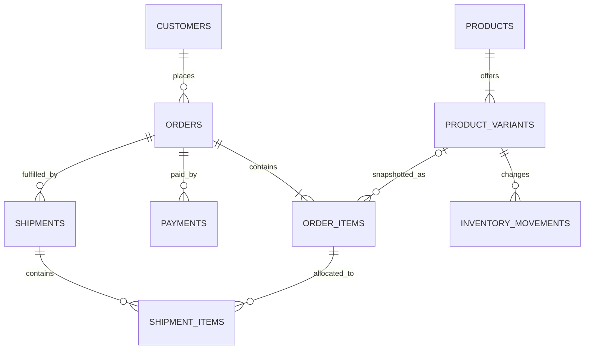

# Solution 1: E-commerce Ordering

## What this addresses

Use this design when a system sells catalog items with variants, accepts payments, ships orders in multiple packages, and must maintain inventory. The hard requirement is historical truth: changing a product name or price tomorrow must not rewrite yesterday's invoice.

## Why this shape

- `products` describe the marketable concept; `product_variants` describe purchasable SKUs.
- `order_items` copy the SKU, name, and unit price at checkout. Those are sale-time facts, not live catalog attributes.
- `payments` and `shipments` are one-to-many because retries, partial captures, refunds, and split shipments are normal.
- `inventory_movements` is an append-only quantity ledger. Current stock is a sum, so every adjustment has an explanation.

## Relationship graph



## PostgreSQL schema

```sql
create schema commerce;

create table commerce.customers (
    customer_id bigint generated always as identity primary key,
    email text not null unique,
    created_at timestamptz not null default now()
);

create table commerce.products (
    product_id bigint generated always as identity primary key,
    name text not null,
    description text,
    is_active boolean not null default true
);

create table commerce.product_variants (
    variant_id bigint generated always as identity primary key,
    product_id bigint not null references commerce.products on delete restrict,
    sku text not null unique,
    price numeric(12,2) not null check (price >= 0),
    attributes jsonb not null default '{}'::jsonb,
    is_active boolean not null default true
);
create index on commerce.product_variants (product_id);

create table commerce.orders (
    order_id bigint generated always as identity primary key,
    customer_id bigint not null references commerce.customers on delete restrict,
    status text not null check (status in ('pending','paid','fulfilling','shipped','cancelled')),
    currency char(3) not null,
    idempotency_key text not null unique,
    shipping_address jsonb not null,
    placed_at timestamptz not null default now()
);
create index on commerce.orders (customer_id, placed_at desc);

create table commerce.order_items (
    order_item_id bigint generated always as identity primary key,
    order_id bigint not null references commerce.orders on delete restrict,
    variant_id bigint references commerce.product_variants on delete set null,
    sku_snapshot text not null,
    name_snapshot text not null,
    unit_price numeric(12,2) not null check (unit_price >= 0),
    quantity int not null check (quantity > 0),
    line_total numeric(14,2) generated always as (unit_price * quantity) stored
);
create index on commerce.order_items (order_id);

create table commerce.payments (
    payment_id bigint generated always as identity primary key,
    order_id bigint not null references commerce.orders on delete restrict,
    provider text not null,
    provider_reference text not null,
    kind text not null check (kind in ('authorization','capture','refund')),
    status text not null check (status in ('pending','succeeded','failed')),
    amount numeric(12,2) not null check (amount > 0),
    created_at timestamptz not null default now(),
    unique (provider, provider_reference, kind)
);
create index on commerce.payments (order_id, created_at);

create table commerce.shipments (
    shipment_id bigint generated always as identity primary key,
    order_id bigint not null references commerce.orders on delete restrict,
    carrier text,
    tracking_number text,
    status text not null check (status in ('pending','shipped','delivered','returned')),
    shipped_at timestamptz,
    unique (carrier, tracking_number)
);

create table commerce.shipment_items (
    shipment_id bigint not null references commerce.shipments on delete cascade,
    order_item_id bigint not null references commerce.order_items on delete restrict,
    quantity int not null check (quantity > 0),
    primary key (shipment_id, order_item_id)
);

create table commerce.inventory_movements (
    movement_id bigint generated always as identity primary key,
    variant_id bigint not null references commerce.product_variants on delete restrict,
    order_id bigint references commerce.orders on delete restrict,
    quantity_delta int not null check (quantity_delta <> 0),
    reason text not null check (reason in ('receipt','reservation','release','sale','return','adjustment')),
    created_at timestamptz not null default now()
);
create index on commerce.inventory_movements (variant_id, created_at);
```

## What the database now guarantees

- Every order item belongs to an order, but historical display does not depend on the live catalog row.
- Payment-provider retries cannot create the same operation twice.
- A shipment can contain part of an order and an order can be split across shipments.
- Every stock change has a signed movement and reason.

## Important boundary

The DDL does not by itself guarantee that shipped quantities never exceed ordered quantities or that captures equal the order total. Those are cross-row sums. Enforce them in a transaction-level service function or deferred constraint trigger, and lock the order while transitioning its state.
