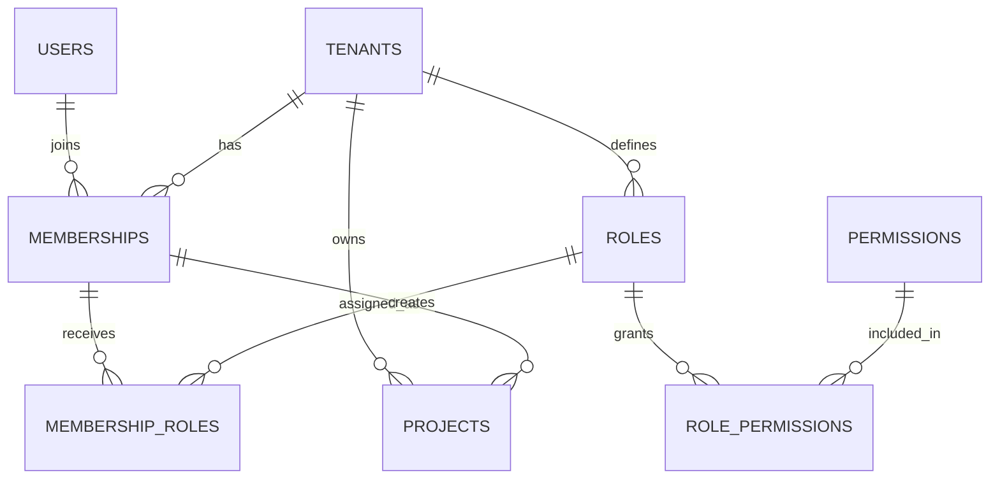
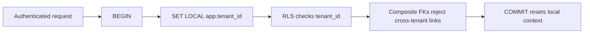

# Solution 2: Multi-tenant SaaS with RBAC

## What this addresses

Use this design when one login can belong to several organizations, hold different roles in each, and own tenant-scoped resources. Its main job is preventing an identifier from one tenant from being attached to a row in another tenant.

## Why this shape

- `users` are global identities; `tenants` are organizations.
- `memberships` represent a user's presence inside a tenant.
- Roles are tenant-owned, permissions are global vocabulary, and junction tables connect them.
- Composite foreign keys include `tenant_id`, so cross-tenant ownership is rejected even when application code is wrong.

## Relationship graph



## PostgreSQL schema

```sql
create schema saas;

create table saas.users (
    user_id bigint generated always as identity primary key,
    email text not null unique,
    created_at timestamptz not null default now()
);

create table saas.tenants (
    tenant_id bigint generated always as identity primary key,
    slug text not null unique,
    name text not null
);

create table saas.memberships (
    tenant_id bigint not null references saas.tenants on delete cascade,
    user_id bigint not null references saas.users on delete cascade,
    status text not null check (status in ('invited','active','suspended')),
    joined_at timestamptz,
    primary key (tenant_id, user_id)
);
create index on saas.memberships (user_id, tenant_id);

create table saas.roles (
    tenant_id bigint not null references saas.tenants on delete cascade,
    role_id bigint generated always as identity,
    name text not null,
    primary key (tenant_id, role_id),
    unique (tenant_id, name)
);

create table saas.permissions (
    permission_code text primary key,
    description text not null
);

create table saas.role_permissions (
    tenant_id bigint not null,
    role_id bigint not null,
    permission_code text not null references saas.permissions on delete cascade,
    primary key (tenant_id, role_id, permission_code),
    foreign key (tenant_id, role_id)
        references saas.roles (tenant_id, role_id) on delete cascade
);

create table saas.membership_roles (
    tenant_id bigint not null,
    user_id bigint not null,
    role_id bigint not null,
    primary key (tenant_id, user_id, role_id),
    foreign key (tenant_id, user_id)
        references saas.memberships (tenant_id, user_id) on delete cascade,
    foreign key (tenant_id, role_id)
        references saas.roles (tenant_id, role_id) on delete cascade
);

create table saas.projects (
    tenant_id bigint not null references saas.tenants on delete cascade,
    project_id bigint generated always as identity,
    owner_user_id bigint not null,
    name text not null,
    primary key (tenant_id, project_id),
    foreign key (tenant_id, owner_user_id)
        references saas.memberships (tenant_id, user_id) on delete restrict
);
```

## Isolation flow



## What the database now guarantees

- A role can be assigned only to a membership in the same tenant.
- A project owner must be an actual member of that project's tenant.
- Tenant deletion removes tenant-owned authorization and project data without deleting the global user.

## Why composite keys matter

A plain `projects.owner_user_id references users(user_id)` proves only that the user exists. It does not prove membership in the tenant. The composite FK turns tenant isolation from a convention into an invariant. Add row-level security as defense in depth; RLS controls visibility, while constraints control what data may exist.
