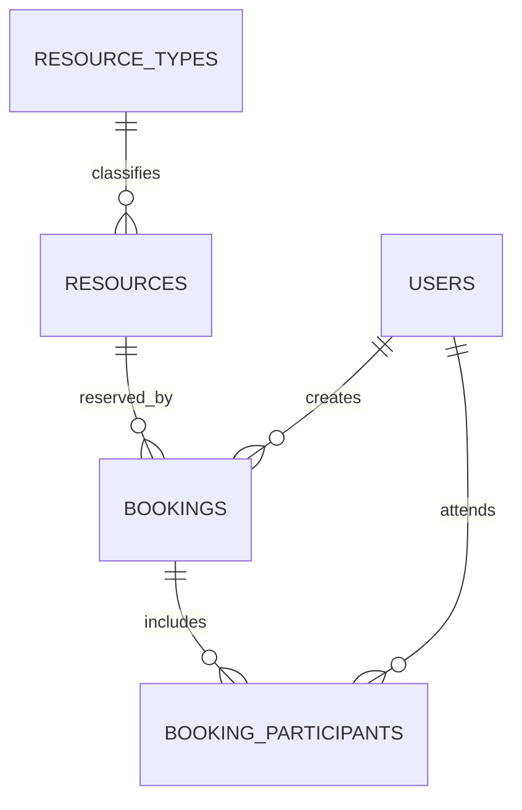
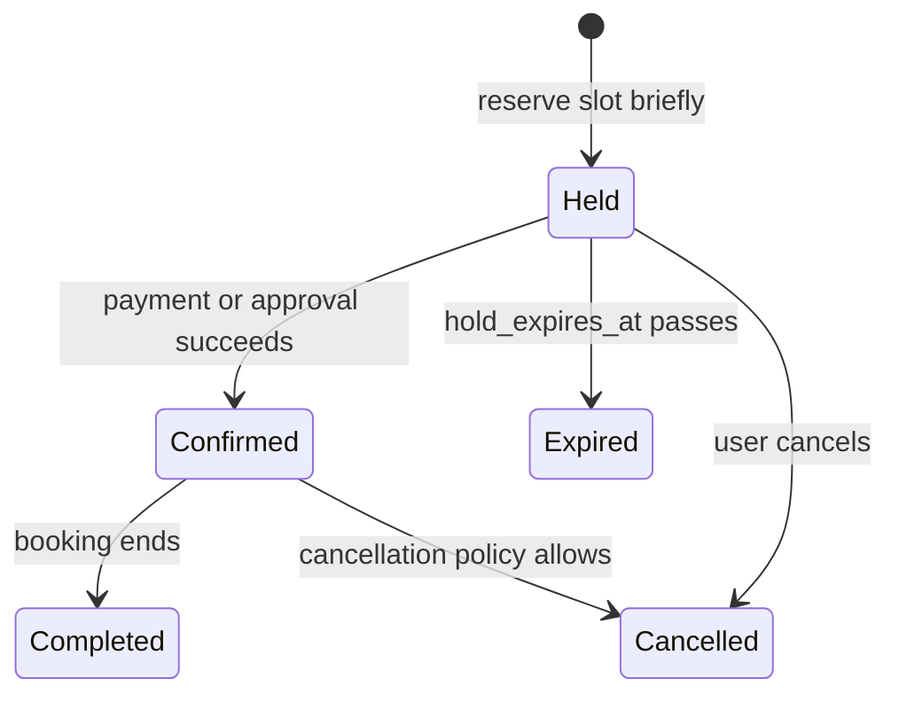

# Solution 3: Booking and Scheduling

## What this addresses

Use this design for rooms, equipment, appointments, rentals, or any resource that cannot be allocated to overlapping active bookings. It also models short-lived checkout holds without inventing a separate reservation table.

## Why this shape

- A booking stores one half-open time range `[start, end)`, avoiding boundary ambiguity.
- A partial GiST exclusion constraint blocks overlaps only for statuses that consume capacity.
- Participants are a junction table because a booking can include many users.
- An idempotency key makes client retries safe.

## Relationship graph



## PostgreSQL schema

```sql
create extension if not exists btree_gist;
create schema booking;

create table booking.users (
    user_id bigint generated always as identity primary key,
    email text not null unique
);

create table booking.resource_types (
    resource_type_id bigint generated always as identity primary key,
    name text not null unique
);

create table booking.resources (
    resource_id bigint generated always as identity primary key,
    resource_type_id bigint not null references booking.resource_types on delete restrict,
    name text not null,
    timezone text not null,
    is_active boolean not null default true,
    unique (resource_type_id, name)
);

create table booking.bookings (
    booking_id bigint generated always as identity primary key,
    resource_id bigint not null references booking.resources on delete restrict,
    created_by bigint not null references booking.users on delete restrict,
    slot tstzrange not null,
    status text not null check (status in ('held','confirmed','cancelled','completed','expired')),
    hold_expires_at timestamptz,
    idempotency_key text not null unique,
    created_at timestamptz not null default now(),
    check (not isempty(slot)),
    check (lower_inc(slot) and not upper_inc(slot)),
    check (status <> 'held' or hold_expires_at is not null),
    exclude using gist (
        resource_id with =,
        slot with &&
    ) where (status in ('held','confirmed'))
);

create table booking.booking_participants (
    booking_id bigint not null references booking.bookings on delete cascade,
    user_id bigint not null references booking.users on delete cascade,
    role text not null check (role in ('host','guest')),
    primary key (booking_id, user_id)
);
create index on booking.booking_participants (user_id, booking_id);
```

## Booking lifecycle



## What the database now guarantees

- Two active bookings for the same resource cannot overlap, even under concurrency.
- A booking interval is non-empty and uses consistent half-open boundaries.
- Participants cannot be duplicated within one booking.

## Operational rule

Expire holds with a worker that updates `held` rows after `hold_expires_at`. Do not put `now()` in the exclusion predicate: index predicates must be immutable. Availability hours, holidays, and maintenance windows can be modeled as additional range tables and checked when creating a booking.
