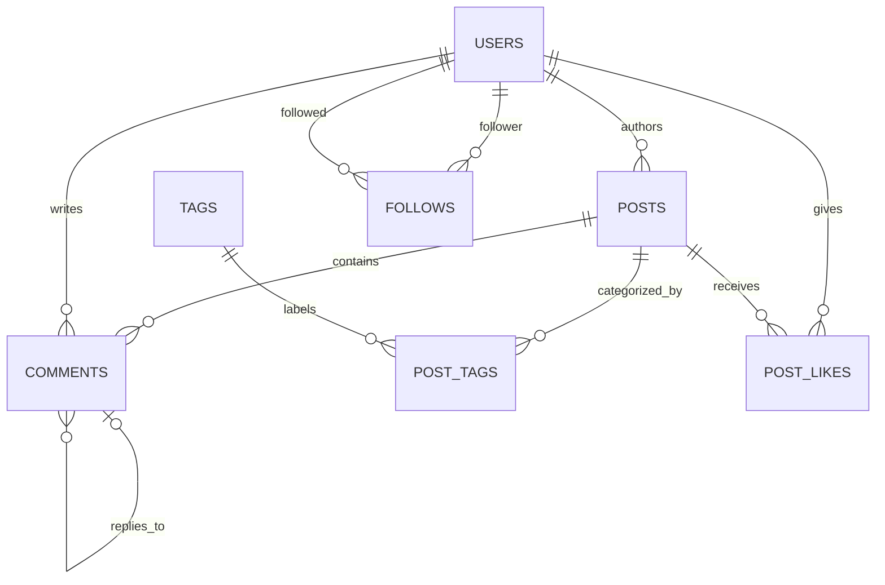
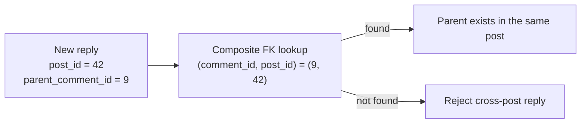

# Solution 4: Content and Social Graph

## What this addresses

Use this design for a publishing or community product with posts, nested comments, tags, likes, and user follows. The difficult parts are keeping comment threads inside their post and representing high-volume many-to-many relationships without duplicated edges.

## Why this shape

- Posts and comments are separate because their lifecycle and query patterns differ.
- A comment carries both `post_id` and `parent_comment_id`; a composite FK proves that its parent belongs to the same post.
- Likes, follows, and post tags are relationship facts, so each is a junction table whose primary key prevents duplicates.
- Counts such as `like_count` are derived. Store them only as an intentional cache with a reconciliation strategy.

## Relationship graph



## PostgreSQL schema

```sql
create schema social;

create table social.users (
    user_id bigint generated always as identity primary key,
    handle text not null unique,
    created_at timestamptz not null default now()
);

create table social.posts (
    post_id bigint generated always as identity primary key,
    author_id bigint not null references social.users on delete restrict,
    title text not null,
    body text not null,
    status text not null check (status in ('draft','published','archived')),
    published_at timestamptz,
    created_at timestamptz not null default now(),
    check (
        (status = 'draft' and published_at is null)
        or (status in ('published','archived') and published_at is not null)
    )
);
create index on social.posts (author_id, created_at desc);
create index on social.posts (published_at desc) where status = 'published';

create table social.comments (
    comment_id bigint generated always as identity primary key,
    post_id bigint not null references social.posts on delete cascade,
    author_id bigint not null references social.users on delete restrict,
    parent_comment_id bigint,
    body text not null,
    created_at timestamptz not null default now(),
    unique (comment_id, post_id),
    foreign key (parent_comment_id, post_id)
        references social.comments (comment_id, post_id) on delete cascade,
    check (parent_comment_id is null or parent_comment_id <> comment_id)
);
create index on social.comments (post_id, created_at);
create index on social.comments (parent_comment_id, created_at);

create table social.tags (
    tag_id bigint generated always as identity primary key,
    slug text not null unique,
    display_name text not null
);

create table social.post_tags (
    post_id bigint not null references social.posts on delete cascade,
    tag_id bigint not null references social.tags on delete cascade,
    added_by bigint not null references social.users on delete restrict,
    added_at timestamptz not null default now(),
    primary key (post_id, tag_id)
);
create index on social.post_tags (tag_id, post_id);

create table social.post_likes (
    user_id bigint not null references social.users on delete cascade,
    post_id bigint not null references social.posts on delete cascade,
    created_at timestamptz not null default now(),
    primary key (user_id, post_id)
);
create index on social.post_likes (post_id, created_at);

create table social.follows (
    follower_id bigint not null references social.users on delete cascade,
    followed_id bigint not null references social.users on delete cascade,
    created_at timestamptz not null default now(),
    primary key (follower_id, followed_id),
    check (follower_id <> followed_id)
);
create index on social.follows (followed_id, follower_id);
```

## Thread-integrity graph



## What the database now guarantees

- A reply cannot point to a comment under a different post.
- The same user cannot like the same post twice or create the same follow edge twice.
- A user cannot follow themselves.
- Deleting a post removes its thread, likes, and tag links while retaining users and tags.

## Scale boundary

For large feeds, do not generate every timeline by joining the entire follow graph at request time. Keep this normalized schema as the source of truth, then build a fan-out cache or materialized feed asynchronously. Search indexes and recommendation features are projections, not replacements for these relational facts.
