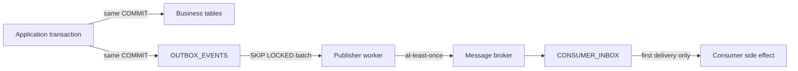

# Solution 5: Transactional Outbox and Idempotent Consumers

## What this addresses

Use this design when a database change must eventually produce a message, webhook, email, or downstream update. It solves the dual-write failure: committing an order and publishing an event are two systems, so one can succeed while the other fails.

## Why this shape

- The application writes business state and an outbox row in the same database transaction.
- A publisher claims committed outbox rows with `FOR UPDATE SKIP LOCKED`, publishes them, and records completion.
- Each consumer records the event in an inbox table in the same transaction as its local side effect. The inbox primary key turns redelivery into a no-op.

## Reliability graph



## PostgreSQL schema

```sql
create schema messaging;

create table messaging.orders (
    order_id bigint generated always as identity primary key,
    status text not null,
    total numeric(12,2) not null check (total >= 0),
    created_at timestamptz not null default now()
);

create table messaging.outbox_events (
    event_id uuid primary key,
    aggregate_type text not null,
    aggregate_id text not null,
    event_type text not null,
    payload jsonb not null,
    occurred_at timestamptz not null default now(),
    available_at timestamptz not null default now(),
    attempts int not null default 0 check (attempts >= 0),
    claimed_at timestamptz,
    claimed_by text,
    published_at timestamptz,
    last_error text,
    check ((claimed_at is null) = (claimed_by is null))
);
create index outbox_ready_idx on messaging.outbox_events (available_at, occurred_at)
where published_at is null;

create table messaging.consumer_inbox (
    consumer_name text not null,
    event_id uuid not null,
    processed_at timestamptz not null default now(),
    primary key (consumer_name, event_id)
);
```

## Producer transaction

```sql
begin;

insert into messaging.orders (status, total)
values ('created', 49.99)
returning order_id;

insert into messaging.outbox_events
    (event_id, aggregate_type, aggregate_id, event_type, payload)
values
    ($1, 'order', $2, 'order.created', $3::jsonb);

commit;
```

## Worker claim pattern

```sql
with batch as (
    select event_id
    from messaging.outbox_events
    where published_at is null
      and available_at <= now()
      and (claimed_at is null or claimed_at < now() - interval '5 minutes')
    order by occurred_at
    for update skip locked
    limit 100
)
update messaging.outbox_events e
set claimed_at = now(), claimed_by = $1, attempts = attempts + 1
from batch
where e.event_id = batch.event_id
returning e.*;
```

Publish outside the claim transaction, then mark success. If the worker crashes after publishing but before marking success, the event is sent again; that is why consumers need the inbox.

## Consumer transaction

```sql
begin;

insert into messaging.consumer_inbox (consumer_name, event_id)
values ($1, $2)
on conflict do nothing
returning event_id;

-- Apply the side effect only when the INSERT returned a row.

commit;
```

## What this solution guarantees

- An event cannot exist without its committed business change, and a committed change cannot miss its outbox row when both writes are in one transaction.
- Multiple publisher workers can claim different rows without blocking each other.
- Redelivery is safe for each named consumer.

## Important boundary

This is at-least-once delivery, not exactly-once transport. Exactly-once *effects* come from idempotency at the consumer. Keep outbox payloads versioned, retain failed rows for investigation, and archive published events according to an explicit retention policy.
