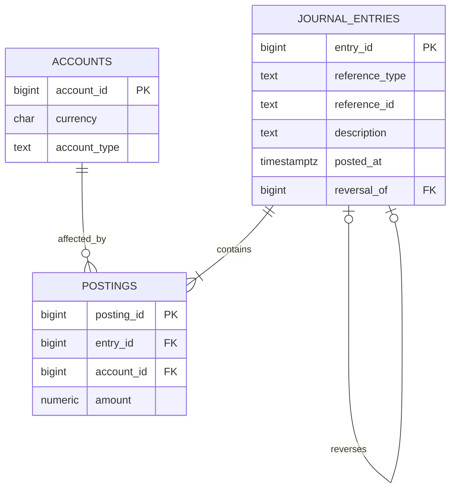
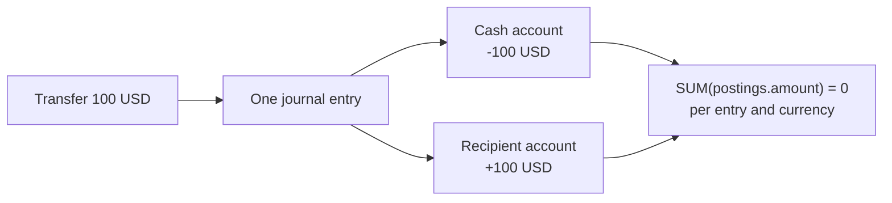

# Solution 6: Double-entry Ledger

## What this addresses

Use this design when balances must be explainable and corrections must preserve history: wallets, internal credits, accounting journals, or payment sub-ledgers. A mutable `accounts.balance` column alone cannot explain how the current value was reached and is easy to corrupt during retries.

## Why this shape

- A journal entry describes one business event.
- Postings distribute that event across accounts as signed amounts.
- Every entry must balance to zero. A transfer of 100 is `-100` from one account and `+100` to another.
- Posted entries are immutable. Corrections are new reversing entries, so the audit trail remains complete.

## Relationship graph



## PostgreSQL schema

```sql
create schema ledger;

create table ledger.accounts (
    account_id bigint generated always as identity primary key,
    owner_type text not null,
    owner_id text not null,
    currency char(3) not null,
    account_type text not null check (account_type in ('asset','liability','revenue','expense','equity')),
    created_at timestamptz not null default now(),
    unique (owner_type, owner_id, currency, account_type),
    unique (account_id, currency)
);

create table ledger.journal_entries (
    entry_id bigint generated always as identity primary key,
    reference_type text not null,
    reference_id text not null,
    description text not null,
    posted_at timestamptz not null default now(),
    reversal_of bigint unique references ledger.journal_entries (entry_id) on delete restrict,
    unique (reference_type, reference_id)
);

create table ledger.postings (
    posting_id bigint generated always as identity primary key,
    entry_id bigint not null references ledger.journal_entries on delete restrict,
    account_id bigint not null,
    currency char(3) not null,
    amount numeric(20,4) not null check (amount <> 0),
    foreign key (account_id, currency)
        references ledger.accounts (account_id, currency) on delete restrict
);
create index on ledger.postings (entry_id);
create index on ledger.postings (account_id, posting_id);
```

`postings.currency` is repeated deliberately. The composite foreign key guarantees that it matches the referenced account's currency, and the deferred trigger can balance each currency independently.

## Posting flow



## Deferred balance check

A normal `CHECK` constraint cannot aggregate sibling rows. Use a deferred constraint trigger so all postings can be inserted before the entry is validated at commit.

```sql
create function ledger.assert_entry_balanced()
returns trigger language plpgsql as $$
declare
    v_entry_id bigint;
begin
    for v_entry_id in
        select distinct id
        from unnest(array[
            case when tg_op <> 'DELETE' then new.entry_id end,
            case when tg_op <> 'INSERT' then old.entry_id end
        ]) as ids(id)
        where id is not null
    loop
        if exists (select 1 from ledger.journal_entries where entry_id = v_entry_id)
           and (
               not exists (
                   select 1 from ledger.postings where entry_id = v_entry_id
               )
               or exists (
                   select 1
                   from ledger.postings
                   where entry_id = v_entry_id
                   group by currency
                   having count(*) < 2 or sum(amount) <> 0
               )
           ) then
            raise exception 'journal entry % is not balanced', v_entry_id;
        end if;
    end loop;
    return null;
end;
$$;

create constraint trigger postings_must_balance
after insert or update or delete on ledger.postings
deferrable initially deferred
for each row execute function ledger.assert_entry_balanced();

create constraint trigger journal_entry_must_have_balanced_postings
after insert or update on ledger.journal_entries
deferrable initially deferred
for each row execute function ledger.assert_entry_balanced();
```

In production, write through a stored procedure that inserts the entry and all postings, locks affected accounts when necessary, and prevents updates or deletes after posting.

## Balance query

```sql
select account_id, currency, sum(amount) as balance
from ledger.postings
where account_id = $1
group by account_id, currency;
```

## What this solution guarantees

- Every recorded business event has explicit account-level effects.
- Duplicate upstream requests are stopped by `(reference_type, reference_id)`.
- Composite foreign keys prevent a posting from using a currency different from its account.
- A deferred check rejects an empty or unbalanced entry at commit.
- Reversals retain both the original event and its correction.

## Important boundary

The triggers validate totals but do not make rows immutable. Immutability belongs in the single posting procedure plus privileges that deny direct table writes. For high-value systems, add an entry status (`draft`/`posted`) and allow mutation only while draft.
