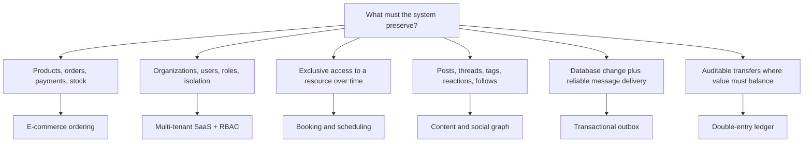

# PostgreSQL Architecture Solutions

These blueprints combine the basic relationship patterns into schemas for common production systems. They are starting points, not universal templates: each chapter states the problem, explains why the tables are separated, shows the relationships, provides PostgreSQL DDL, and calls out the invariants that must hold.

## Choose a blueprint

| Solution | What it addresses | Central idea |
|---|---|---|
| [E-commerce ordering](01_ecommerce_ordering.md) | Catalog, variants, immutable orders, payments, shipments, stock | Snapshot sale-time facts; record stock as movements |
| [Multi-tenant SaaS + RBAC](02_multitenant_saas_rbac.md) | Shared users, organizations, memberships, permissions, tenant-safe ownership | Carry `tenant_id` through relationship keys |
| [Booking and scheduling](03_booking_scheduling.md) | Temporary holds and non-overlapping reservations | Store time as a range; enforce overlap rules with `EXCLUDE` |
| [Content and social graph](04_content_social.md) | Posts, comment threads, tags, likes, follows | Use junction tables and a composite FK for thread integrity |
| [Transactional outbox](05_transactional_outbox.md) | Reliable event publication after a database commit | Commit state and event in one transaction; deduplicate consumers |
| [Double-entry ledger](06_double_entry_ledger.md) | Auditable balances, transfers, corrections | Immutable journal entries whose postings sum to zero |

## How to use these solutions

1. Start with the closest blueprint and delete features you do not need.
2. Preserve its integrity rules even if you rename tables.
3. Add indexes for actual query paths; foreign keys are not automatically indexed by PostgreSQL.
4. Treat mutable operational state and immutable historical facts differently.
5. Verify every cross-table business invariant: a foreign key alone rarely expresses the whole rule.
