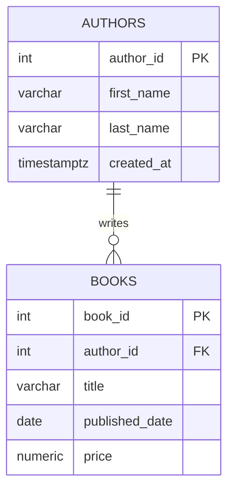

# PATTERN 1: ONE-TO-MANY (1:N)

The most fundamental pattern. One parent has many children.

## VISUALIZATION



## RULES

- FK lives on the "many" side (`books.author_id`)
- `NOT NULL` on the FK makes the parent mandatory; nullable makes it optional
- Choose the `ON DELETE` action deliberately (see the table below)
- **Always index FK columns yourself** — PostgreSQL creates an index for a PRIMARY KEY and UNIQUE constraint, but **not** for a FOREIGN KEY

That last point is the most commonly missed fact in this file. An unindexed FK hurts twice: joins from parent to child are slow, and every `DELETE` or key `UPDATE` on the **parent** must scan the entire child table to check for references — so deleting one author can seq-scan a million books.

### ON DELETE actions

| Action | Effect on child rows | Use when |
|---|---|---|
| `NO ACTION` (default) | Blocks the delete; check runs at end of statement | The relationship is mandatory and deletion should be an explicit decision |
| `RESTRICT` | Blocks the delete; check runs immediately, cannot be deferred | Same, but you want it to fail fast |
| `CASCADE` | Deletes children too | Children are meaningless alone (order → order_items) |
| `SET NULL` | Orphans keep their data, FK becomes NULL | The parent is optional metadata (post → category) |
| `SET DEFAULT` | FK becomes the column default | You have a genuine fallback row |

`CASCADE` deserves caution: it's silent and it's recursive. A cascade chain can delete far more than you intended, and it will not appear in any application log. For anything user-facing, prefer `RESTRICT` and delete explicitly.

```sql
drop schema if exists one_to_many cascade;
create schema one_to_many;

-- Parent table
create table one_to_many.authors (
    author_id   int generated always as identity primary key,
    first_name  varchar(100) not null,
    last_name   varchar(100) not null,
    created_at  timestamptz not null default now()
);
-- NOTE: it is tempting to add `unique (first_name, last_name)` here. Don't.
-- Two different people genuinely share a name, and you have just made it
-- impossible to store the second one. Names are not identifiers. If you need
-- deduplication, do it in the UI as a warning, not as a constraint.

-- Child table — FK lives on the "many" side
create table one_to_many.books (
    book_id       int generated always as identity primary key,
    title         varchar(300) not null,
    author_id     int not null,
    published_date date,
    price         numeric(8, 2) check (price >= 0),
    created_at    timestamptz not null default now(),

    -- FK with CASCADE: deleting an author removes all their books
    constraint fk_books_author
        foreign key (author_id)
        references one_to_many.authors (author_id)
        on delete cascade
    -- `on update cascade` is omitted deliberately: an IDENTITY primary key is
    -- never updated, so the clause is dead weight. It matters only for natural
    -- keys that can genuinely change (a country code, a username).
);

-- Index on FK — PostgreSQL does NOT create this automatically
create index idx_books_author_id on one_to_many.books (author_id);
```

## COMMON VARIATIONS

### Variation A: Optional parent (nullable FK)

A book MAY have a translator, but doesn't have to.

```sql
create table one_to_many.translators (
    translator_id int generated always as identity primary key,
    name          varchar(200) not null
);

create table one_to_many.translations (
    translation_id int generated always as identity primary key,
    book_id        int not null,
    translator_id  int,  -- NULLABLE: translation may not have a translator yet
    language       varchar(50) not null,
    constraint fk_translation_book
        foreign key (book_id)
        references one_to_many.books (book_id)
        on delete cascade,
    constraint fk_translation_translator
        foreign key (translator_id)
        references one_to_many.translators (translator_id)
        on delete set null  -- orphaned translation keeps its data
);
```

### Variation B: SET DEFAULT instead of CASCADE

When you want a fallback "unknown" record instead of deleting

```sql
create table one_to_many.categories (
    category_id int generated always as identity primary key,
    name        varchar(100) not null unique
);

-- Insert the "uncategorized" fallback first — SET DEFAULT fails at runtime if
-- the default value does not exist in the parent table.
insert into one_to_many.categories (category_id, name)
overriding system value values (0, 'Uncategorized');

create table one_to_many.products (
    product_id   int generated always as identity primary key,
    name         varchar(200) not null,
    category_id  int not null default 0,  -- 0 = 'Uncategorized'
    constraint fk_product_category
        foreign key (category_id)
        references one_to_many.categories (category_id)
        on delete set default  -- orphans go to 'Uncategorized'
);

create index idx_products_category on one_to_many.products (category_id);
```

Two details that make `SET DEFAULT` work in practice:

- **Reserve the sentinel id explicitly.** Relying on "the first insert gets id 1" breaks the moment a seed runs twice or someone deletes the row. `OVERRIDING SYSTEM VALUE` lets you pin it to a value (0) that the identity sequence will never generate.
- **`SET DEFAULT` is a runtime check, not a schema-time one.** If the default value has no matching parent row, the FK violation surfaces only when someone actually deletes a category.

## TYPICAL QUERIES

```sql
-- All books by a specific author
select b.title, b.published_date
from one_to_many.books b
where b.author_id = 1;

-- Authors ranked by number of books
select a.first_name, a.last_name, count(b.book_id) as book_count
from one_to_many.authors a
  left join one_to_many.books b on a.author_id = b.author_id
group by a.author_id, a.first_name, a.last_name
order by book_count desc;

-- Authors with NO books (finding orphans on the parent side).
-- Prefer NOT EXISTS over NOT IN: if the subquery can return NULL,
-- `NOT IN` returns no rows at all — a classic silent wrong answer.
select a.first_name, a.last_name
from one_to_many.authors a
where not exists (
    select 1 from one_to_many.books b where b.author_id = a.author_id
);

-- Most recent book per author (lateral join — efficient "top N per group")
select a.last_name, b.title, b.published_date
from one_to_many.authors a
  left join lateral (
      select title, published_date
      from one_to_many.books
      where author_id = a.author_id
      order by published_date desc nulls last
      limit 1
  ) b on true;
```

Note the `group by a.author_id, a.first_name, a.last_name` in the count query above. Because `author_id` is the primary key, PostgreSQL's functional-dependency detection lets you write just `group by a.author_id` — the other columns are implied. That's a PostgreSQL extension, not standard SQL, so listing them all is more portable.

## COMMON MISTAKES

- **Putting the FK on the "one" side.** A single `authors.book_id` column can only reference one book, which makes it a 1:1. If you find yourself wanting `book_id_1`, `book_id_2`, the FK is on the wrong table.
- **Forgetting to index the FK column.** PostgreSQL won't do it for you, and the cost shows up on parent deletes, not just joins.
- **Reaching for `CASCADE` by default.** It deletes silently and recursively. Use it when the child cannot exist independently; otherwise `RESTRICT`.
- **Storing the author's name in `books`.** Denormalization without a measured reason, and now the name has two homes that can disagree. The exception is a deliberate historical snapshot (see `../interview_sql_nodejs/07_practical_scenarios.md` Q2 — an invoice line must keep the price it was sold at).
- **Making the FK nullable when the relationship is mandatory.** A nullable `author_id` says "a book might have no author"; if that's untrue, `NOT NULL` documents it and lets the planner optimize.

## KEY TAKEAWAYS

- FK always on the "many" side
- Index every FK column — PostgreSQL does not
- Choose `CASCADE` vs `SET NULL` vs `RESTRICT` deliberately, and default to `RESTRICT`
- `NOT NULL` on the FK is how you say "mandatory"
