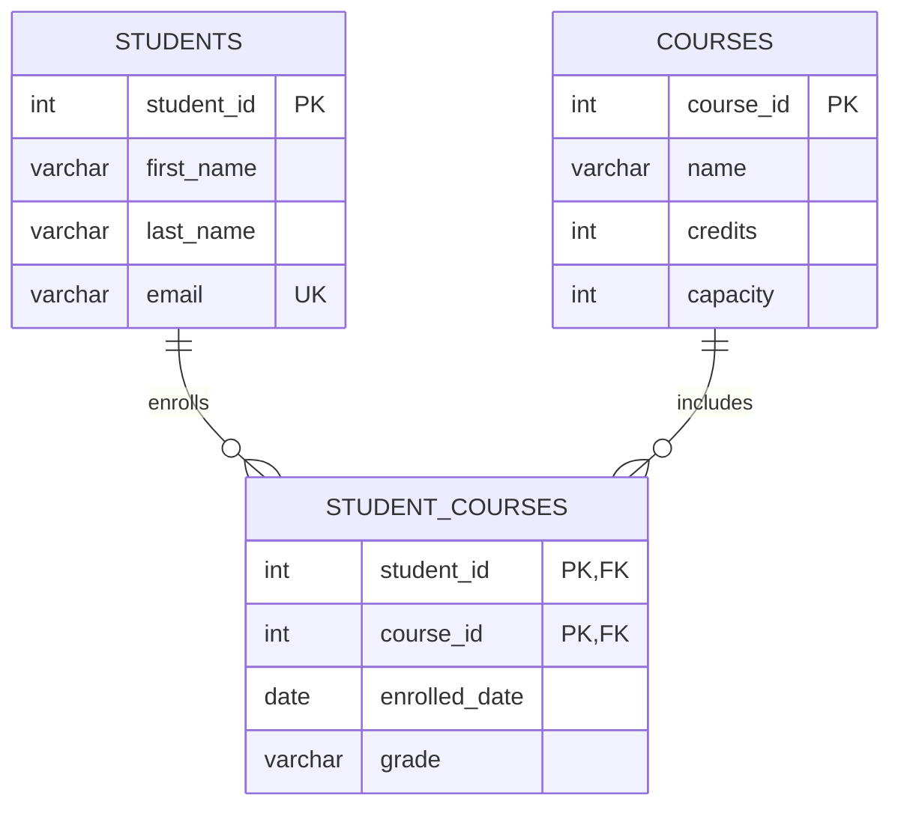

# PATTERN 2: MANY-TO-MANY (M:N)

Two entities where each can relate to many of the other. Requires a JUNCTION (bridge/linking) table.

## VISUALIZATION



The junction table's PK is a **composite** of both FKs. That single choice prevents duplicate enrollments — no application check required.

## RULES

- Composite PK of both FKs, rather than a surrogate `id` — it *is* the uniqueness rule
- Each FK in the junction table references its parent, both `NOT NULL`
- Relationship attributes (grade, enrolled date, role) belong on the junction table
- **Index the second FK column.** The composite PK `(student_id, course_id)` already indexes lookups by `student_id` (leftmost prefix), but a query filtering only on `course_id` cannot use it. Column order in the PK therefore determines which direction is fast for free — pick the order matching your most common query, and add a separate index for the other direction.

```sql
drop schema if exists many_to_many cascade;
create schema many_to_many;

-- Entity A
create table many_to_many.students (
    student_id int generated always as identity primary key,
    first_name varchar(100) not null,
    last_name  varchar(100) not null,
    email      varchar(200) unique
);

-- Entity B
create table many_to_many.courses (
    course_id int generated always as identity primary key,
    name      varchar(200) not null,
    credits   int check (credits between 1 and 6),
    capacity  int check (capacity > 0)
);

-- JUNCTION TABLE — the heart of M:N
create table many_to_many.student_courses (
    student_id    int not null,
    course_id     int not null,
    enrolled_date date not null default current_date,

    -- varchar, not char(2): char blank-pads to a fixed width, so 'A' is stored
    -- and returned as 'A '. NULL (not yet graded) passes the CHECK because
    -- NULL comparisons yield NULL, which a CHECK treats as satisfied.
    grade         varchar(2) check (grade in ('A', 'B', 'C', 'D', 'F', 'W')),

    -- Composite PK: prevents enrolling the same student in the same course twice
    primary key (student_id, course_id),

    constraint fk_sc_student
        foreign key (student_id)
        references many_to_many.students (student_id)
        on delete cascade,
    constraint fk_sc_course
        foreign key (course_id)
        references many_to_many.courses (course_id)
        on delete cascade
);

-- The PK covers lookups by student_id. This covers the reverse direction.
create index idx_sc_course on many_to_many.student_courses (course_id);
```

> ⚠️ **`x IN ('A', 'B', NULL)` does not permit NULL.** It's the single most common bug in CHECK constraints. `NULL IN (...)` evaluates to NULL, never TRUE — so listing `null` among the allowed values accomplishes nothing. It happens to work here only because a CHECK constraint passes when its expression is NULL rather than FALSE. If you want to *forbid* NULL, that's `NOT NULL`; if you want to allow it, it already is allowed. Writing `null` in the list just misleads the next reader.

## EXTENDED: Many-to-Many with extra attributes

When the relationship itself has data (e.g., team membership with role)

```sql
create table many_to_many.projects (
    project_id int generated always as identity primary key,
    name       varchar(200) not null
);

create table many_to_many.team_members (
    student_id  int not null,
    project_id  int not null,
    role        varchar(50) not null check (role in ('lead', 'developer', 'reviewer')),
    joined_date date not null default current_date,
    left_date   date,
    check (left_date is null or left_date >= joined_date),

    primary key (student_id, project_id),
    constraint fk_tm_student
        foreign key (student_id)
        references many_to_many.students (student_id)
        on delete cascade,
    constraint fk_tm_project
        foreign key (project_id)
        references many_to_many.projects (project_id)
        on delete cascade
);
```

### The moment the composite PK becomes wrong

Adding `joined_date`/`left_date` quietly changed what the relationship *means*. The composite PK says a student can be on a project **once, ever** — so someone who leaves and rejoins cannot be recorded. The relationship is no longer M:N between two entities; it's M:N *over time*, which is a different pattern.

Two ways out, depending on what you need:

```sql
-- Option 1: add the start date to the key. Allows re-joining, still prevents
-- two rows with the same start.
primary key (student_id, project_id, joined_date)

-- Option 2 (stronger): forbid OVERLAPPING memberships with an exclusion
-- constraint. This is the only version that actually prevents a student
-- being on the same project twice at the same time.
create extension if not exists btree_gist;

create table many_to_many.team_members_temporal (
    membership_id int generated always as identity primary key,
    student_id    int not null references many_to_many.students (student_id) on delete cascade,
    project_id    int not null references many_to_many.projects (project_id) on delete cascade,
    role          varchar(50) not null,
    period        daterange not null default daterange(current_date, null, '[)'),

    exclude using gist (
        student_id with =,
        project_id with =,
        period     with &&        -- && is "ranges overlap"
    )
);
```

Option 2 is the case where a **surrogate PK on a junction table is correct** — the uniqueness rule is "no overlapping periods," which a composite PK cannot express. The general rule stands (composite PK by default), but the reason is that the composite key *is* the business rule; when it isn't, don't force it. See `07_temporal.md` for more on range types.

## TYPICAL QUERIES

```sql
-- All courses for a student
select c.name, sc.grade
from many_to_many.courses c
  join many_to_many.student_courses sc using (course_id)
where sc.student_id = 1;

-- All students in a course (with enrollment date)
select s.first_name, s.last_name, sc.enrolled_date
from many_to_many.students s
  join many_to_many.student_courses sc using (student_id)
where sc.course_id = 5
order by sc.enrolled_date;

-- Course enrollment count (respecting capacity)
select c.name,
       count(sc.student_id) as enrolled,
       c.capacity,
       c.capacity - count(sc.student_id) as remaining_spots
from many_to_many.courses c
  left join many_to_many.student_courses sc using (course_id)
group by c.course_id, c.name, c.capacity;

-- Students who share at least one course (pairing)
select s1.first_name || ' ' || s1.last_name as student1,
       s2.first_name || ' ' || s2.last_name as student2,
       c.name as shared_course
from many_to_many.student_courses sc1
  join many_to_many.student_courses sc2
    on sc1.course_id = sc2.course_id and sc1.student_id < sc2.student_id
  join many_to_many.students s1 on sc1.student_id = s1.student_id
  join many_to_many.students s2 on sc2.student_id = s2.student_id
  join many_to_many.courses c on sc1.course_id = c.course_id
order by student1, student2;
```

## ENFORCING CAPACITY

The `remaining_spots` query reports capacity but nothing enforces it — two concurrent enrollments can both see one spot left and both take it. A CHECK constraint can't help, because it can only see one row. The options:

```sql
-- Option 1: serialize on the parent row during enrollment
begin;
select capacity from many_to_many.courses where course_id = 5 for update;
-- count current enrollments, compare, then insert
commit;

-- Option 2: denormalize a counter maintained by a trigger, with a CHECK on it
alter table many_to_many.courses add column enrolled_count int not null default 0
    check (enrolled_count <= capacity);
```

Option 2 makes the invariant a real database constraint, at the cost of a trigger and contention on the counter row. This is the standard tradeoff for any "count of children must not exceed a limit on the parent" rule — SQL has no declarative way to express it.

## COMMON MISTAKES

- **Storing comma-separated IDs in a column** (`'3,7,12'`). No FK, no index, no type checking, and every query needs string splitting. This is a 1NF violation — see `11_normalization.md`.
- **Adding a surrogate PK to the junction table "for consistency"** and then forgetting the `UNIQUE (a_id, b_id)` constraint. Now duplicates are possible. If you add a surrogate key, you still owe the unique constraint.
- **Trying M:N with a single FK,** or with two columns on one side (`course_id_1`, `course_id_2`).
- **Indexing only the leftmost direction.** The composite PK covers one; the other needs its own index.
- **Not thinking about the reverse cascade.** `ON DELETE CASCADE` on both FKs is usually right for a junction table — the link is meaningless once either side is gone — but it means deleting a course silently erases every student's grade for it.

## KEY TAKEAWAYS

- Composite PK on the junction prevents duplicates declaratively
- Extra relationship data belongs on the junction table
- The PK indexes one direction; index the other yourself
- When the relationship varies over time, the composite PK stops being sufficient — reach for an exclusion constraint
