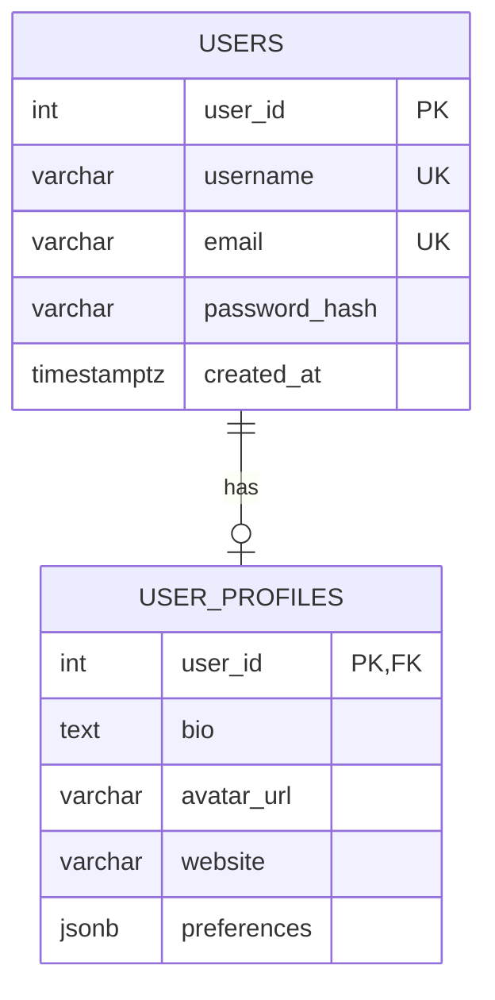

# PATTERN 3: ONE-TO-ONE (1:1)

Each row in A maps to exactly one row in B. Used to SPLIT a wide table into logical groups.

## VISUALIZATION



## WHY SPLIT?

- Separate auth data from public profile data
- Profile may not exist yet (lazy creation)
- Different access patterns / security requirements
- Some columns are rarely queried (cold data)

## ENFORCEMENT

- FK on the child side (`profiles.user_id` → `users.user_id`)
- The FK column must also be **unique**, or you have a 1:N

Making the FK column the child's **primary key** is the cleanest way to do this — it gives you uniqueness, `NOT NULL`, and an index in one declaration, and it removes a pointless surrogate `profile_id` that nothing would ever reference. A separate `id` column plus `UNIQUE (user_id)` also works and is what most ORMs generate; it's just redundant.

Note what this does *not* enforce: it guarantees **at most one** profile per user, not **exactly one**. Every 1:1 in a relational database is really 1:0..1 unless you add something extra — see below.

```sql
drop schema if exists one_to_one cascade;
create schema one_to_one;

-- Core identity table — always exists
create table one_to_one.users (
    user_id       int generated always as identity primary key,
    username      varchar(50) not null unique,
    email         varchar(200) not null unique,
    password_hash varchar(255) not null,
    created_at    timestamptz not null default now()
);

-- Extended profile — may not exist for every user
create table one_to_one.user_profiles (
    user_id      int primary key,  -- PK + FK = 1:1 enforcement
    bio          text,
    avatar_url   varchar(500),
    website      varchar(300),
    preferences  jsonb not null default '{}'::jsonb,
    updated_at   timestamptz not null default now(),

    constraint fk_profile_user
        foreign key (user_id)
        references one_to_one.users (user_id)
        on delete cascade
        on update cascade
);
```

## MANDATORY 1:1 (exactly one, not zero-or-one)

Sometimes both halves must exist together — an `orders` row and its `order_shipping` row, say. The child already points at the parent; making the parent require a child creates a **circular dependency**, since neither row can be inserted first.

`DEFERRABLE INITIALLY DEFERRED` resolves it: the constraint is checked at `COMMIT` rather than per statement, so both rows can be inserted in either order within one transaction.

```sql
create table one_to_one.orders (
    order_id    int generated always as identity primary key,
    total       numeric(10,2) not null,
    shipping_id int not null
);

create table one_to_one.order_shipping (
    shipping_id int generated always as identity primary key,
    order_id    int not null unique,
    address     text not null,
    constraint fk_shipping_order
        foreign key (order_id) references one_to_one.orders (order_id)
        on delete cascade
        deferrable initially deferred
);

alter table one_to_one.orders
    add constraint fk_order_shipping
    foreign key (shipping_id) references one_to_one.order_shipping (shipping_id)
    deferrable initially deferred;

-- Both inserts must now happen in ONE transaction
begin;
  insert into one_to_one.orders (total, shipping_id) values (99.99, 1);
  insert into one_to_one.order_shipping (order_id, address) values (1, '1 Main St');
commit;  -- both FKs validated here
```

This is genuinely awkward, and that awkwardness is a signal. **If two tables must always exist together, that is usually one table.** Reach for deferred circular FKs only when the split is justified by something else on this page (security boundary, hot/cold access), not to model "mandatory."

## ALTERNATIVE: Split by access frequency

Hot data (queried often) vs Cold data (rarely accessed).

**A caveat worth knowing before you split for performance:** PostgreSQL already does this automatically. Large values (>2KB) are compressed and moved out of the main row into a separate TOAST table, and are only read when the column is actually selected. So splitting a table just to keep a big `text` or `jsonb` column out of the hot path is often solving a problem the storage engine already solved.

Splitting genuinely helps when you have *many* medium-sized columns that don't individually qualify for TOAST — those still make each row physically wider, so fewer rows fit per 8KB page and every sequential scan reads more pages. Measure with `pg_column_size()` and `pg_total_relation_size()` before splitting.

```sql
create table one_to_one.accounts (
    account_id    int generated always as identity primary key,
    email         varchar(200) not null unique,
    status        varchar(20) not null check (status in ('active', 'suspended', 'deleted')),
    last_login    timestamptz
);

-- Rarely accessed compliance / billing info
create table one_to_one.account_compliance (
    account_id   int primary key,
    tax_id       varchar(50),
    billing_addr text,
    verified_at  timestamptz,
    constraint fk_compliance_account
        foreign key (account_id)
        references one_to_one.accounts (account_id)
        on delete cascade
);
```

## ALTERNATIVE: Split mandatory vs optional

```sql
create table one_to_one.employees (
    employee_id int generated always as identity primary key,
    first_name  varchar(100) not null,
    last_name   varchar(100) not null,
    dept_id     int not null
);

-- Optional extended info
create table one_to_one.employee_details (
    employee_id int primary key,
    emergency_contact varchar(200),
    emergency_phone   varchar(30),
    parking_spot      varchar(10),
    constraint fk_detail_employee
        foreign key (employee_id)
        references one_to_one.employees (employee_id)
        on delete cascade
);
```

## TYPICAL QUERIES

```sql
-- Get user with profile (LEFT JOIN — profile may not exist)
select u.username, u.email, p.bio, p.avatar_url
from one_to_one.users u
  left join one_to_one.user_profiles p on u.user_id = p.user_id;

-- Create profile lazily on first update (upsert)
insert into one_to_one.user_profiles (user_id, bio)
values (1, 'Hello, I am a developer.')
on conflict (user_id) do update set bio = excluded.bio, updated_at = now();

-- Users who have NOT completed their profile
select u.username
from one_to_one.users u
where not exists (
    select 1 from one_to_one.user_profiles p where p.user_id = u.user_id
);
```

**The lazy-creation pattern has a cost the diagram hides:** every read now needs a `LEFT JOIN`, and every consumer must handle the NULL case. If you find yourself writing `coalesce(p.bio, '')` everywhere, the profile isn't really optional — create an empty profile row alongside the user and use `NOT NULL DEFAULT` columns instead.

## WHEN TO USE 1:1 vs SINGLE TABLE

### Use 1:1 when:

- Some rows genuinely don't have the second part yet
- Different security/access requirements
- Significant performance benefit (splitting hot/cold data)
- Different teams own different parts of the schema

### Use SINGLE TABLE when:

- Every row always has all columns
- The extra JOIN hurts more than it helps
- You're over-engineering for a simple domain

### COMMON MISTAKES:

- **Creating a 1:1 table for every optional column.** A nullable column is cheaper than a join. PostgreSQL stores NULLs in a per-row bitmap, so a nullable column costs roughly one bit when unset — the "wasted space" argument for splitting is almost always wrong at small scale.
- **Forgetting uniqueness on the FK side.** Without it you've built a 1:N and won't notice until two profiles exist for one user.
- **Splitting for performance without measuring.** See the TOAST note above.
- **Assuming 1:1 means "exactly one."** It means "at most one" unless you add a deferred circular FK or a trigger.
- **Cascading the wrong direction.** `ON DELETE CASCADE` belongs on the child (deleting a user removes their profile). A cascade from profile → user would delete the account when someone clears their bio.

### KEY TAKEAWAYS

- Shared PK on the child is the cleanest enforcement: unique, not-null, and indexed in one line
- Default to a single table with nullable columns; split only for a reason you can name
- "Exactly one" requires deferred constraints — and usually means it should have been one table
