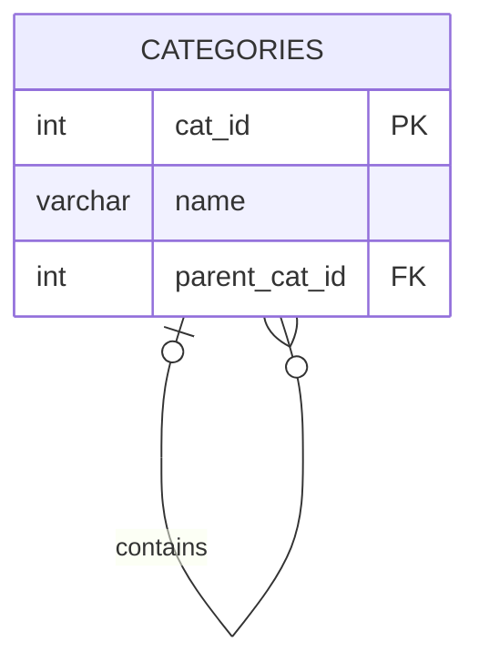
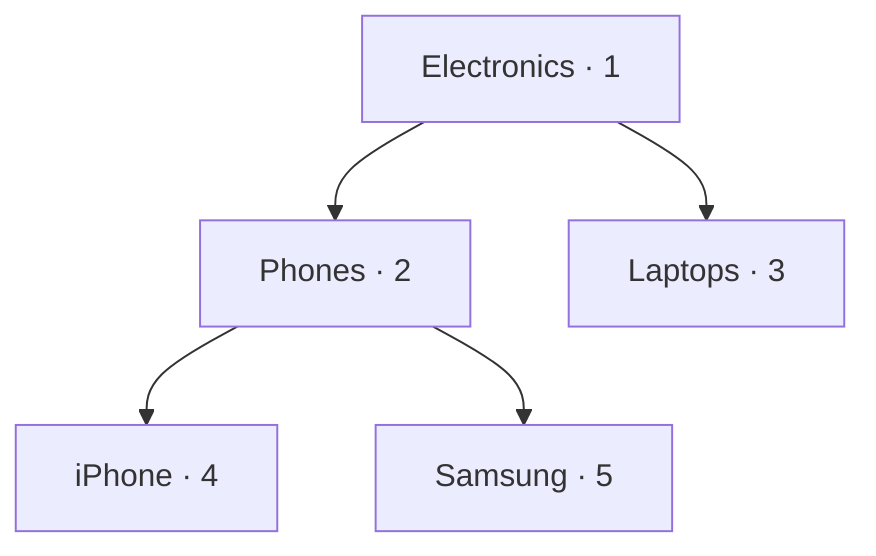

# PATTERN 4: SELF-REFERENCING (HIERARCHICAL)

A table references itself. Used for trees, categories, org charts, comment threads, and bill of materials.

## VISUALIZATION (Adjacency List)





```sql
drop schema if exists self_ref cascade;
create schema self_ref;
```

## APPROACH A: Adjacency List (simple, most common)

Each row stores its direct parent. Use CTEs for traversal.

```sql
create table self_ref.categories (
    cat_id        int generated always as identity primary key,
    name          varchar(100) not null,
    parent_cat_id int,
    -- A row cannot be its own parent. This catches the trivial 1-cycle only;
    -- longer cycles (A→B→A) need the trigger below.
    constraint chk_not_self_parent check (parent_cat_id <> cat_id),
    constraint fk_category_parent
        foreign key (parent_cat_id)
        references self_ref.categories (cat_id)
        on delete set null  -- orphans become roots
);

create index idx_categories_parent on self_ref.categories (parent_cat_id);

-- Sample data. Inserted in dependency order so each parent exists first.
insert into self_ref.categories (name, parent_cat_id) values
    ('Electronics', null),
    ('Phones', 1),
    ('Laptops', 1),
    ('iPhone', 2),
    ('Samsung', 2),
    ('Clothing', null),
    ('Men', 6),
    ('Women', 6);
```

### Preventing cycles

An adjacency list will happily store `A → B → C → A`, and any recursive query over it then loops forever. The FK doesn't help: every row has a valid parent. You need a trigger.

```sql
create or replace function self_ref.check_no_cycle() returns trigger as $$
begin
    if new.parent_cat_id is null then
        return new;
    end if;
    -- Walk up from the proposed parent; if we reach the row itself, it's a cycle
    if exists (
        with recursive ancestors as (
            select cat_id, parent_cat_id from self_ref.categories
            where cat_id = new.parent_cat_id
            union all
            select c.cat_id, c.parent_cat_id
            from self_ref.categories c
              join ancestors a on c.cat_id = a.parent_cat_id
        )
        select 1 from ancestors where cat_id = new.cat_id
    ) then
        raise exception 'Cycle detected: category % cannot be a descendant of itself', new.cat_id;
    end if;
    return new;
end;
$$ language plpgsql;

create trigger trg_categories_no_cycle
    before insert or update of parent_cat_id on self_ref.categories
    for each row execute function self_ref.check_no_cycle();
```

Note this trigger is itself safe only because the table has no cycle *yet* — it prevents the first one from being created. If bad data already exists, the recursive CTE inside the trigger will hang; clean up first, or add a `CYCLE` clause (below).

### Cycle-safe traversal (PostgreSQL 14+)

Even with the trigger, defensive queries are cheap. The `CYCLE` clause stops recursion instead of spinning:

```sql
with recursive tree as (
    select cat_id, name, parent_cat_id, 0 as depth
    from self_ref.categories where cat_id = 1
    union all
    select c.cat_id, c.name, c.parent_cat_id, t.depth + 1
    from self_ref.categories c join tree t on c.parent_cat_id = t.cat_id
) cycle cat_id set is_cycle using path
select cat_id, name, depth from tree where not is_cycle;
```

Before PG 14, cap the recursion with `where t.depth < 50` in the recursive term.

### Query: All children of a category (recursive CTE)

```sql
with recursive tree as (
    select cat_id, name, parent_cat_id, 0 as depth
    from self_ref.categories
    where cat_id = 1  -- start from root
    union all
    select c.cat_id, c.name, c.parent_cat_id, t.depth + 1
    from self_ref.categories c
      join tree t on c.parent_cat_id = t.cat_id
)
select repeat('  ', depth) || name as path from tree;
```

### Query: Full path from root to node

```sql
with recursive path as (
    select cat_id, name, parent_cat_id, name::text as full_path
    from self_ref.categories
    where parent_cat_id is null
    union all
    select c.cat_id, c.name, c.parent_cat_id,
           p.full_path || ' > ' || c.name
    from self_ref.categories c
      join path p on c.parent_cat_id = p.cat_id
)
select cat_id, full_path from path order by full_path;
```

## APPROACH B: Materialized Path (fast reads, harder writes)

Store the full path as a string. No recursion needed for reads.

```sql
create table self_ref.materialized_cats (
    cat_id   int generated always as identity primary key,
    name     varchar(100) not null,
    path     varchar(1000) not null,  -- e.g., "/1/2/4/"
    depth    int not null default 0,
    -- Path must start and end with '/'. (The tempting
    -- `path not like '%/%/%'` is wrong — it matches even '/1/', so it would
    -- reject every valid path.)
    constraint chk_path_format check (path ~ '^/([0-9]+/)+$'),
    -- A root path '/1/' has 2 slashes and depth 0, so depth = slashes - 2
    constraint chk_depth_matches
        check (depth = length(path) - length(replace(path, '/', '')) - 2)
);

-- CRITICAL: the index that makes this pattern worth using.
-- Plain B-tree indexes cannot serve LIKE 'prefix%' unless the database is in
-- the C locale — text_pattern_ops makes prefix matching work in any locale.
create index idx_matcats_path on self_ref.materialized_cats (path text_pattern_ops);

-- Sample data
insert into self_ref.materialized_cats (name, path, depth) values
    ('Electronics', '/1/', 0),
    ('Phones', '/1/2/', 1),
    ('Laptops', '/1/3/', 1),
    ('iPhone', '/1/2/4/', 2),
    ('Samsung', '/1/2/5/', 2),
    ('Clothing', '/6/', 0),
    ('Men', '/6/7/', 1);

-- Query: All descendants — index-backed prefix scan, no recursion
select * from self_ref.materialized_cats
where path like '/1/%' order by path;

-- Query: All ancestors of node 4 — its own path contains their ids
select m.name, m.depth
from self_ref.materialized_cats target
  join self_ref.materialized_cats m
    on target.path like m.path || '%'   -- m is an ancestor of (or equal to) target
where target.cat_id = 4
order by m.depth;
```

**Two traps in materialized path:**

- **The path duplicates the FK.** Nothing stops `path` from disagreeing with reality — there's no `parent_id` to check it against, and no FK at all. Most implementations keep both a `parent_id` (FK, source of truth) and a `path` (derived, maintained by trigger).
- **Moving a subtree rewrites every descendant.** `update ... set path = replace(path, '/1/2/', '/3/2/') where path like '/1/2/%'` — correct, but it touches every row underneath, and `replace` will corrupt paths if an id appears elsewhere in the string. Anchor the replacement with `overlay()` or regex.

## APPROACH B2: `ltree` — PostgreSQL's built-in materialized path

Before hand-rolling paths, know that PostgreSQL ships a purpose-built type. It's the right default for tree-shaped data in Postgres.

```sql
create extension if not exists ltree;

create table self_ref.ltree_cats (
    cat_id int generated always as identity primary key,
    name   varchar(100) not null,
    path   ltree not null
);

-- GiST index supports ancestor/descendant operators
create index idx_ltree_path on self_ref.ltree_cats using gist (path);

insert into self_ref.ltree_cats (name, path) values
    ('Electronics', 'electronics'),
    ('Phones',      'electronics.phones'),
    ('iPhone',      'electronics.phones.iphone'),
    ('Clothing',    'clothing');

-- Descendants of 'electronics' (<@ means "is contained by")
select name, path from self_ref.ltree_cats where path <@ 'electronics';

-- Ancestors of a node (@> means "contains")
select name from self_ref.ltree_cats where path @> 'electronics.phones.iphone';

-- Pattern matching: any node two levels under electronics
select name from self_ref.ltree_cats where path ~ 'electronics.*{1}';

-- Depth comes for free
select name, nlevel(path) as depth from self_ref.ltree_cats;
```

`ltree` gives you indexed ancestor/descendant queries, depth, and glob-style matching without recursive CTEs or string parsing. Its limits: labels are restricted to alphanumerics and underscores, and moving a subtree still means updating descendants (`update ... set path = 'new' || subpath(path, nlevel('old'))`).

## APPROACH C: Closure Table (best of both worlds)

Separate table stores ALL ancestor-descendant pairs. Fast reads AND easy writes.

```sql
create table self_ref.closure_nodes (
    node_id int generated always as identity primary key,
    name    varchar(100) not null
);

create table self_ref.closure_edges (
    ancestor int not null,
    descendant int not null,
    depth int not null check (depth >= 0),
    primary key (ancestor, descendant),
    constraint fk_edge_ancestor
        foreign key (ancestor) references self_ref.closure_nodes (node_id)
        on delete cascade,
    constraint fk_edge_descendant
        foreign key (descendant) references self_ref.closure_nodes (node_id)
        on delete cascade
);

-- Index the reverse direction (PK covers ancestor-first lookups only)
create index idx_edges_descendant on self_ref.closure_edges (descendant, depth);
```

### Maintaining the closure table

This is the part that's usually left out, and it's the whole cost of the pattern. Every node needs an edge to *each* of its ancestors, not just its parent.

```sql
-- Insert a ROOT node: only the depth-0 self-edge
insert into self_ref.closure_nodes (name) values ('Electronics');
insert into self_ref.closure_edges (ancestor, descendant, depth)
values (1, 1, 0);

-- Insert a CHILD node under parent 1: self-edge, plus one edge from every
-- ancestor of the parent (including the parent itself, at depth+1).
insert into self_ref.closure_nodes (name) values ('Phones');   -- gets node_id 2

insert into self_ref.closure_edges (ancestor, descendant, depth)
select e.ancestor, 2, e.depth + 1
from self_ref.closure_edges e
where e.descendant = 1          -- all ancestors of the parent
union all
select 2, 2, 0;                 -- the new node's own self-edge
```

So a node at depth *d* creates *d+1* rows. The table holds one row per ancestor-descendant pair — for a balanced tree that's O(n log n), but for a deep or unbalanced tree it approaches O(n²). That storage cost buys you O(1) subtree queries.

```sql
-- Delete a subtree: remove every edge touching any descendant
delete from self_ref.closure_edges
where descendant in (
    select descendant from self_ref.closure_edges where ancestor = 2
);

-- Query: All descendants of node 1
select n.name, e.depth
from self_ref.closure_edges e
  join self_ref.closure_nodes n on e.descendant = n.node_id
where e.ancestor = 1 and e.depth > 0
order by e.depth, n.name;

-- Query: All ancestors of node 4 (the reverse — same table, no extra work)
select n.name, e.depth
from self_ref.closure_edges e
  join self_ref.closure_nodes n on e.ancestor = n.node_id
where e.descendant = 4 and e.depth > 0
order by e.depth desc;

-- Query: Direct children only
select n.name
from self_ref.closure_edges e
  join self_ref.closure_nodes n on e.descendant = n.node_id
where e.ancestor = 1 and e.depth = 1;

-- Query: Leaf nodes (no descendants other than themselves)
select n.name
from self_ref.closure_nodes n
where not exists (
    select 1 from self_ref.closure_edges e
    where e.ancestor = n.node_id and e.depth > 0
);
```

The `depth` column is what makes a closure table strictly more useful than a plain reachability table: without it you can't distinguish direct children from distant descendants, and you can't order a subtree by level.

## APPROACH COMPARISON

| Approach | Direct parent | All ancestors | All descendants | Insert | Move subtree | Storage | Referential integrity |
|---|---|---|---|---|---|---|---|
| Adjacency List | O(1) | Recursive | Recursive | O(1) | **O(1)** | n | Full (FK) |
| Materialized Path | Parse string | O(1) index | O(1) index | O(1) | O(subtree) | n × depth | None |
| `ltree` | `subpath()` | O(1) GiST | O(1) GiST | O(1) | O(subtree) | n × depth | None |
| Closure Table | O(1) | O(1) | O(1) | O(depth) | O(subtree × depth) | O(n log n)–O(n²) | Full (FK) |

Note the correction to a common claim: in an adjacency list, reading the **direct parent** is one row, but reading **all ancestors** still requires recursion. Only the first hop is cheap.

Moving a subtree is the reverse: it's the one operation the adjacency list wins outright, because a move is a single `UPDATE` of one `parent_id`. Every denormalized approach has to rewrite the whole subtree.

### RECOMMENDATION

- **Default: adjacency list + recursive CTE.** Modern PostgreSQL handles recursive CTEs well, and for the tree sizes most applications have (thousands of nodes, tens of levels) the "slow" traversal is single-digit milliseconds. Start here and only move if you measure a problem.
- **Read-heavy trees on PostgreSQL: `ltree`.** Prefer it over hand-rolled materialized paths — indexed, typed, and already debugged.
- **Closure table:** when you need fast queries in *both* directions and the tree is genuinely deep, or when you need graph-like structures (a node with multiple parents) that the other models can't express.
- **Hybrid, common in production:** adjacency list as the source of truth with a FK, plus a trigger-maintained `path` or closure table as a derived index. You get integrity and speed at the cost of trigger complexity.

### COMMON MISTAKES

- **No cycle protection.** The FK permits `A → B → A`, and one recursive query then hangs the connection. Add the trigger.
- **Recursive CTE with no depth cap.** Even without cycles, a runaway `union` (using `union all` where the join condition is wrong) will spin. Use the `CYCLE` clause or a `depth <` guard.
- **`LIKE 'prefix%'` on a path column with no `text_pattern_ops` index.** The query is correct and seq-scans every row, so the pattern's whole advantage disappears.
- **Forgetting the depth-0 self-edge in a closure table.** Without it, "all descendants including self" and subtree deletes silently miss the root.
- **Storing sibling order as a plain integer.** Inserting between positions 3 and 4 means renumbering everything after. Use a fractional/sparse ordering (gaps of 1000) or an explicit `previous_sibling_id` linked list.
- **`ON DELETE CASCADE` on the self-FK.** Deleting a root then silently deletes the entire tree. `SET NULL` (promote children to roots) or `RESTRICT` are usually safer defaults.
