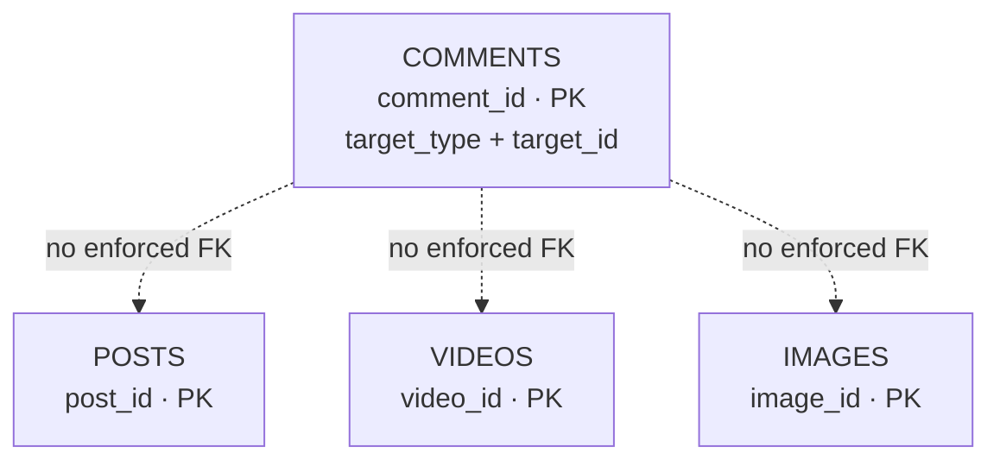

# PATTERN 5: POLYMORPHIC ASSOCIATIONS

One table relates to MULTIPLE other tables. E.g., a Comment can belong to a Post, Video, or Image.

## VISUALIZATION



**WARNING:** True polymorphic FKs cannot be enforced by the database. You must enforce referential integrity in application code or triggers.

```sql
drop schema if exists polymorphic cascade;
create schema polymorphic;
```

## APPROACH A: Type Discriminator Column (common but fragile)

Simple but NO database-level referential integrity.

```sql
create table polymorphic.posts (
    post_id int generated always as identity primary key,
    title   varchar(300) not null,
    body    text
);

create table polymorphic.videos (
    video_id int generated always as identity primary key,
    title    varchar(300) not null,
    duration int check (duration > 0)
);

create table polymorphic.images (
    image_id int generated always as identity primary key,
    url      varchar(500) not null,
    caption  text
);

-- Polymorphic comments table
create table polymorphic.comments (
    comment_id int generated always as identity primary key,
    body       text not null,
    target_type varchar(20) not null check (target_type in ('post', 'video', 'image')),
    target_id  int not null,
    created_at timestamptz not null default now()
);

-- Cannot create a FK constraint here — the DB doesn't know which table to reference.
-- Referential integrity must be enforced in application code.

-- The composite index the pattern is useless without
create index idx_comments_target on polymorphic.comments (target_type, target_id);

-- Query: Get all comments for a post
select c.body, c.created_at
from polymorphic.comments c
where c.target_type = 'post' and c.target_id = 1;
```

**What "no referential integrity" actually costs you,** beyond the abstract principle:

- **Orphans accumulate silently.** Deleting a post leaves its comments behind, pointing at an id that no longer exists — or worse, at an id that a *new* post later reuses, so old comments reappear under unrelated content.
- **No `ON DELETE CASCADE`.** Every delete path in the application must remember to clean up every polymorphic child. Miss one and you leak rows forever.
- **Joins can't be expressed.** Fetching "comments with their targets" needs a `UNION ALL` over each type, or N queries, and the planner can't use FK-based optimizations.
- **`target_id` types must match.** If posts use `int` and videos use `uuid`, a single `target_id` column cannot hold both without stringifying everything.

You will need a periodic orphan sweep:

```sql
delete from polymorphic.comments c
where c.target_type = 'post'
  and not exists (select 1 from polymorphic.posts p where p.post_id = c.target_id);
```

Running that on a schedule is the tell that you've traded a database guarantee for a cron job. Sometimes worth it — Rails' and Laravel's ORMs make this pattern very convenient — but it should be a decision, not a default.

## APPROACH B: Separate FK Columns (enforceable, more columns)

Each possible target gets its own FK column. Only one is non-NULL.

```sql
create table polymorphic.comments_safe (
    comment_id int generated always as identity primary key,
    body       text not null,
    post_id    int,
    video_id   int,
    image_id   int,
    created_at timestamptz not null default now(),

    -- Exactly one must be non-null. num_nonnulls() expresses this directly;
    -- the hand-written OR-chain grows quadratically with each new target type
    -- and is easy to get subtly wrong.
    constraint chk_one_target check (num_nonnulls(post_id, video_id, image_id) = 1),

    constraint fk_comment_post
        foreign key (post_id) references polymorphic.posts (post_id) on delete cascade,
    constraint fk_comment_video
        foreign key (video_id) references polymorphic.videos (video_id) on delete cascade,
    constraint fk_comment_image
        foreign key (image_id) references polymorphic.images (image_id) on delete cascade
);

-- Partial indexes: only index rows where each FK is actually set
create index idx_cs_post on polymorphic.comments_safe (post_id) where post_id is not null;
create index idx_cs_video on polymorphic.comments_safe (video_id) where video_id is not null;
create index idx_cs_image on polymorphic.comments_safe (image_id) where image_id is not null;

-- Query: Get all comments regardless of target
select 'post' as type, p.title, c.body
from polymorphic.comments_safe c join polymorphic.posts p on c.post_id = p.post_id
union all
select 'video', v.title, c.body
from polymorphic.comments_safe c join polymorphic.videos v on c.video_id = v.video_id
union all
select 'image', i.caption, c.body
from polymorphic.comments_safe c join polymorphic.images i on c.image_id = i.image_id;
```

This approach is sometimes called the **"exclusive arc."** It gives you real foreign keys and real cascades, at the price of one nullable column per target type. That price is fine at three targets and untenable at fifteen — which is exactly the decision boundary between Approach B and Approach D.

## APPROACH C: Separate Comment Tables (cleanest, most normalized)

One comment table per target. No polymorphism needed.

```sql
create table polymorphic.post_comments (
    comment_id int generated always as identity primary key,
    post_id    int not null,
    body       text not null,
    created_at timestamptz not null default now(),
    constraint fk_pc_post
        foreign key (post_id) references polymorphic.posts (post_id) on delete cascade
);

create table polymorphic.video_comments (
    comment_id int generated always as identity primary key,
    video_id   int not null,
    body       text not null,
    created_at timestamptz not null default now(),
    constraint fk_vc_video
        foreign key (video_id) references polymorphic.videos (video_id) on delete cascade
);
```

## APPROACH D: Shared Supertype (the structurally correct answer)

The reason polymorphism is awkward here is that the schema is missing a concept. "Things that can be commented on" is a real entity in the domain — it just doesn't have a table. Give it one, and the polymorphic association collapses into an ordinary foreign key.

```sql
-- The supertype: identity and everything common to all content
create table polymorphic.content_items (
    content_id int generated always as identity primary key,
    type       varchar(20) not null check (type in ('post', 'video', 'image')),
    author_id  int not null,
    created_at timestamptz not null default now(),

    -- Lets subtype tables verify they attach to the RIGHT type (see below)
    unique (content_id, type)
);

-- Subtype tables hold only what's specific to that type — no NULL columns
create table polymorphic.post_details (
    content_id int primary key,
    type       varchar(20) not null generated always as ('post') stored,
    title      varchar(300) not null,
    body       text not null,
    -- Composite FK: guarantees this row attaches to a content_item of type 'post'
    foreign key (content_id, type)
        references polymorphic.content_items (content_id, type) on delete cascade
);

create table polymorphic.video_details (
    content_id int primary key,
    type       varchar(20) not null generated always as ('video') stored,
    title      varchar(300) not null,
    duration   int not null check (duration > 0),
    foreign key (content_id, type)
        references polymorphic.content_items (content_id, type) on delete cascade
);

-- Comments now use a plain, fully-enforced foreign key
create table polymorphic.content_comments (
    comment_id int generated always as identity primary key,
    content_id int not null,
    body       text not null,
    created_at timestamptz not null default now(),
    constraint fk_cc_content
        foreign key (content_id) references polymorphic.content_items (content_id) on delete cascade
);

create index idx_cc_content on polymorphic.content_comments (content_id, created_at);
```

The trick worth remembering is the **composite FK on `(content_id, type)`**. Without it, nothing stops a `post_details` row from attaching to a content item of type `'video'`. The generated `type` column is a constant, so the FK can only resolve against a parent whose type matches.

```sql
-- All comments with their target, one query, no UNION
select ci.type, coalesce(pd.title, vd.title) as title, c.body
from polymorphic.content_comments c
  join polymorphic.content_items ci using (content_id)
  left join polymorphic.post_details pd using (content_id)
  left join polymorphic.video_details vd using (content_id);
```

**Cost:** every content type needs a row in two tables, inserted together in a transaction. **Benefit:** full referential integrity, cascades that work, no UNION queries, and adding a new content type never touches the `comments` table. Any other feature that applies to "all content" — likes, tags, moderation flags, view counts — also becomes a plain FK to `content_items`. That's usually the deciding factor: if comments are the *only* polymorphic relationship you'll ever have, Approach B is simpler; if there will be several, the supertype pays for itself immediately.

## APPROACH COMPARISON

| Approach | FK integrity | Query all targets | Adding a target type | Best when |
|---|---|---|---|---|
| **A** Type discriminator | ❌ None | UNION or N queries | Insert a CHECK value | You're matching an ORM convention and accept the tradeoff |
| **B** Separate FK columns | ✅ Enforced | UNION ALL | `ALTER TABLE` + widen CHECK | 2–4 target types, unlikely to grow |
| **C** Separate tables | ✅ Enforced | UNION ALL | New table | Targets have genuinely different comment semantics |
| **D** Shared supertype | ✅ Enforced | Plain join | New subtype table only | Many targets, or several polymorphic relationships |

### RECOMMENDATION

- **Default to D (shared supertype)** when the targets are conceptually the same kind of thing — "content," "documents," "transactions." The extra table is not overhead; it's the entity you were missing.
- **B (separate FK columns)** for two or three unrelated targets where a supertype would be contrived.
- **C (separate tables)** when the "same" relationship actually differs per target — if post comments need threading and video comments need timestamps, they were never one table.
- **A only** when an ORM convention forces it and you're prepared to run orphan sweeps.

The decisive question is: *is there a real entity that all these targets are instances of?* If yes → D. If no, and you're only linking them for storage convenience → B or C.

### COMMON MISTAKES

- **Using a polymorphic FK with no enforcement and no cleanup job.** Orphans accumulate, and id reuse eventually attaches old children to unrelated new parents.
- **Adding a new target type without updating the CHECK constraint** — writes then fail at runtime, usually in production, usually on a Friday.
- **Not indexing `(target_type, target_id)` together.** An index on `target_id` alone still scans every type.
- **Hand-writing the mutual-exclusion CHECK** instead of `num_nonnulls(...) = 1`. The OR-chain has *n* clauses of *n* terms and people routinely miss a case.
- **Omitting the composite FK in the supertype pattern,** which lets a subtype row attach to a parent of the wrong type.
- **Mismatched key types across targets** (`int` posts, `uuid` videos) — forces `target_id` to become text and destroys index efficiency.

### KEY TAKEAWAYS

- The database cannot enforce a FK that points to more than one table. Every approach here is a way of avoiding that need.
- A polymorphic association is usually a missing entity in disguise.
- If you do choose the discriminator column, index `(type, id)` and schedule an orphan sweep — don't just accept the loss of integrity silently.
