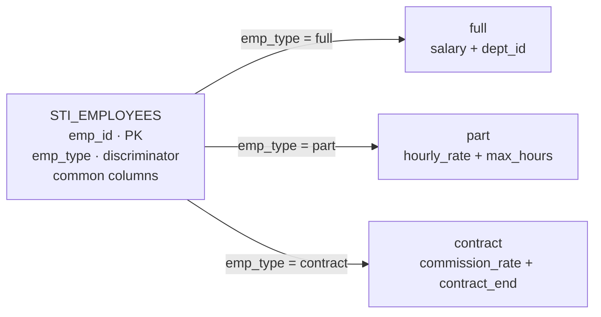
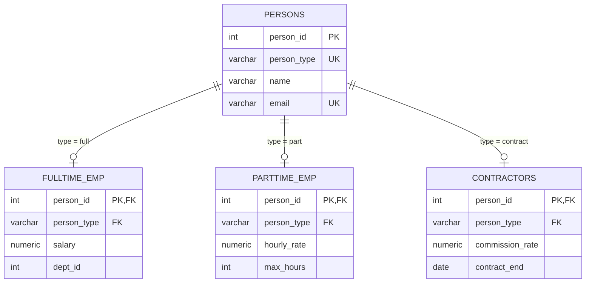
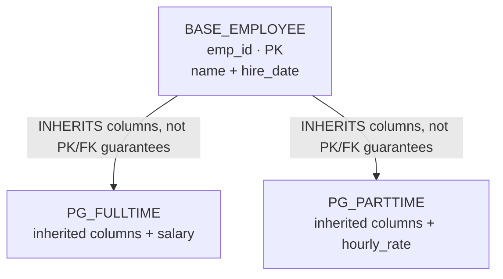

# PATTERN 6: INHERITANCE MODELS

Representing "is-a" relationships in relational databases. E.g., Employee IS-A Person. Manager IS-A Employee. THREE APPROACHES COMPARED.

```sql
drop schema if exists inheritance cascade;
create schema inheritance;
```

## APPROACH A: SINGLE TABLE INHERITANCE (STI)

All types in one table with a type discriminator. Simple queries, but sparse rows with many NULLs.

### VISUALIZATION



```sql
create table inheritance.sti_employees (
    emp_id          int generated always as identity primary key,
    emp_type        varchar(10) not null check (emp_type in ('full', 'part', 'contract')),
    name            varchar(200) not null,
    email           varchar(200) unique,
    salary          numeric(10, 2),
    dept_id         int,
    hourly_rate     numeric(8, 2),
    max_hours       int check (max_hours between 1 and 40),
    commission_rate numeric(5, 2) check (commission_rate between 0 and 100),
    contract_end    date,

    -- WITHOUT THIS, STI HAS NO INTEGRITY AT ALL.
    -- Every subtype column is nullable (it has to be — it doesn't apply to
    -- other types), so nothing stops a contractor row from having a salary
    -- and no commission rate. A per-type CHECK restores what the nullable
    -- columns gave away.
    constraint chk_type_columns check (
        case emp_type
            when 'full' then
                salary is not null and dept_id is not null
                and hourly_rate is null and max_hours is null
                and commission_rate is null and contract_end is null
            when 'part' then
                hourly_rate is not null and max_hours is not null
                and salary is null and dept_id is null
                and commission_rate is null and contract_end is null
            when 'contract' then
                commission_rate is not null and contract_end is not null
                and salary is null and dept_id is null
                and hourly_rate is null and max_hours is null
        end
    )
);
```

This constraint is the difference between STI as a legitimate design and STI as a bag of nullable columns. It's also the pattern's real cost: it grows with *types × columns*, must be rewritten on every `ALTER`, and produces an unhelpful error message when violated. That's the tradeoff you accept for single-table queries.

## APPROACH B: CLASS TABLE INHERITANCE (CTI)

One base table + one table per subtype. Normalized, no NULLs, but requires JOINs.

### VISUALIZATION



The naive version — a base table plus three child tables, each with a plain FK — has a hole: **nothing prevents one person from appearing in all three subtype tables at once.** Each FK is checked independently, so a person can be simultaneously full-time, part-time, and a contractor. Since the whole point of subtyping is that the types are mutually exclusive, that's a serious gap.

The fix is the same composite-FK trick as `05_polymorphic.md` Approach D: put a discriminator on the base table and make each subtype's FK reference `(id, type)`.

```sql
create table inheritance.persons (
    person_id int generated always as identity primary key,
    person_type varchar(10) not null check (person_type in ('full', 'part', 'contract')),
    name      varchar(200) not null,
    email     varchar(200) unique,

    -- Target for the subtype tables' composite FK
    unique (person_id, person_type)
);

create table inheritance.fulltime_emp (
    person_id   int primary key,
    person_type varchar(10) not null generated always as ('full') stored,
    salary      numeric(10, 2) not null,
    dept_id     int not null,
    -- Composite FK: this row can only attach to a person of type 'full'
    constraint fk_ft_person foreign key (person_id, person_type)
        references inheritance.persons (person_id, person_type) on delete cascade
);

create table inheritance.parttime_emp (
    person_id   int primary key,
    person_type varchar(10) not null generated always as ('part') stored,
    hourly_rate numeric(8, 2) not null,
    max_hours   int not null check (max_hours between 1 and 40),
    constraint fk_pt_person foreign key (person_id, person_type)
        references inheritance.persons (person_id, person_type) on delete cascade
);

create table inheritance.contractors (
    person_id       int primary key,
    person_type     varchar(10) not null generated always as ('contract') stored,
    commission_rate numeric(5, 2) not null check (commission_rate between 0 and 100),
    contract_end    date not null,
    constraint fk_ct_person foreign key (person_id, person_type)
        references inheritance.persons (person_id, person_type) on delete cascade
);
```

Because `person_type` on each child is a generated constant, the FK can only resolve when the parent's type matches — the database now enforces disjointness. What it still can't enforce is **completeness** (that every person has a row in *some* subtype table); that requires a deferred constraint or a trigger, and most designs accept it as an application invariant.

```sql
-- Query: All persons with their type and pay info (all three subtypes joined)
select p.name,
       p.person_type,
       coalesce(
         ft.salary::text,
         pt.hourly_rate::text || '/hr',
         ct.commission_rate::text || '%'
       ) as pay_info
from inheritance.persons p
  left join inheritance.fulltime_emp ft on p.person_id = ft.person_id
  left join inheritance.parttime_emp pt on p.person_id = pt.person_id
  left join inheritance.contractors   ct on p.person_id = ct.person_id;
```

Note the original version of this query omitted the contractors join and hardcoded the string `'contract'` — with three subtypes you need three joins, and this is precisely the cost CTI imposes: **every query touching all types needs N joins,** and adding a subtype means editing every such query.

## APPROACH C: PostgreSQL NATIVE INHERITANCE (avoid)

PostgreSQL has built-in table inheritance with `CREATE TABLE ... INHERITS`. **Do not use it for modelling subtypes.** It is a legacy feature whose main historical purpose — table partitioning — was replaced by declarative partitioning in PostgreSQL 10.

### VISUALIZATION



```sql
create table inheritance.base_employee (
    emp_id int generated always as identity primary key,
    name   varchar(200) not null,
    hire_date date not null default current_date
);

create table inheritance.pg_fulltime (
    salary numeric(10, 2) not null
) inherits (inheritance.base_employee);

create table inheritance.pg_parttime (
    hourly_rate numeric(8, 2) not null
) inherits (inheritance.base_employee);

-- Query includes child tables by default
select emp_id, name from inheritance.base_employee; -- includes children

-- Query only the base table
select emp_id, name from only inheritance.base_employee;
```

### Why this is a trap

Children inherit **columns, NOT NULL, and CHECK constraints** — and nothing else. In particular:

```sql
-- The base table's PRIMARY KEY is NOT inherited by children.
insert into inheritance.pg_fulltime (name, salary) values ('Alice', 80000);
insert into inheritance.pg_parttime (name, hourly_rate) values ('Bob', 25);
-- Both may receive emp_id = 1. The "primary key" is not unique across the
-- hierarchy, and no error is raised.
```

The full list of what silently doesn't work:

- **PRIMARY KEY and UNIQUE are not inherited.** There is no way to enforce uniqueness across a hierarchy. Duplicate ids are not just possible, they're likely — children share the base sequence only for the default, and direct inserts bypass nothing.
- **Foreign keys are not inherited,** in either direction. A FK pointing at `base_employee` will **not** match rows that live in a child table — so `references base_employee(emp_id)` silently fails to see most of your data.
- **`ON CONFLICT` doesn't work** across the hierarchy.
- **Most ORMs don't model it,** and migration tools frequently mangle it.
- `TRUNCATE`, `UPDATE`, and `DELETE` on the parent affect children unless you write `ONLY` — which is easy to forget in exactly the wrong place.

The uniqueness and FK failures are unrecoverable in-model: you cannot bolt a working PK onto an inheritance hierarchy. That's why this belongs in the "know it exists" category rather than the toolbox. If you want partitioning, use `PARTITION BY`; if you want subtypes, use CTI.

## APPROACH COMPARISON

| Approach | Query one type | Query all types | Integrity | Adding a type | Storage |
|---|---|---|---|---|---|
| **STI** | `WHERE type = ...` | Trivial — one table | Only via a large CHECK | `ALTER TABLE` (locks) | Sparse, many NULLs |
| **CTI** | Join base + subtype | N joins or a UNION | Full, declarative | New table (no lock) | Compact |
| **PG native** | `FROM child` | `FROM parent` | ❌ **Broken** (no PK, no FK) | New table | Compact |

### RECOMMENDATION

- **Few types, mostly-shared columns, queries that span all types:** STI — with the per-type CHECK constraint. This is the pragmatic default, and it's what most ORMs generate.
- **Many types, or subtypes with substantial distinct data, or strict integrity requirements:** CTI with composite FKs.
- **PG native inheritance:** don't. Use declarative partitioning for partitioning, CTI for subtypes.
- **Also consider: a hybrid.** Common columns as real columns, type-specific attributes in a `jsonb` column (see `08_jsonb_flexible.md`). You lose per-field constraints but gain the ability to add a type without a migration. Good for genuinely open-ended type sets like product categories; bad when the subtypes are known and stable.

**The question that actually decides it:** how often do you query across all types versus within one type? Cross-type queries are free in STI and expensive in CTI; that asymmetry usually matters more than the NULL count.

### COMMON MISTAKES

- **STI without a per-type CHECK constraint.** Nullable subtype columns mean any row can hold any combination of fields. This is the single most common criticism of STI and it's entirely avoidable.
- **CTI without a discriminator and composite FK.** One person ends up in three subtype tables, and no error is ever raised.
- **Assuming PG native inheritance enforces the base table's PK.** It does not — you get duplicate ids across children with no warning.
- **Pointing a foreign key at a PG-native inheritance parent.** It won't match rows in child tables.
- **Not planning for type migration.** People change from contractor to full-time. In STI that's an `UPDATE`; in CTI it's a delete plus insert across two tables in a transaction, plus whatever history you need to keep.
- **Modelling as subtypes what is really a role.** If an employee can be *both* a manager and an engineer, that isn't inheritance — it's a many-to-many with a roles table (`02_many_to_many.md`).
