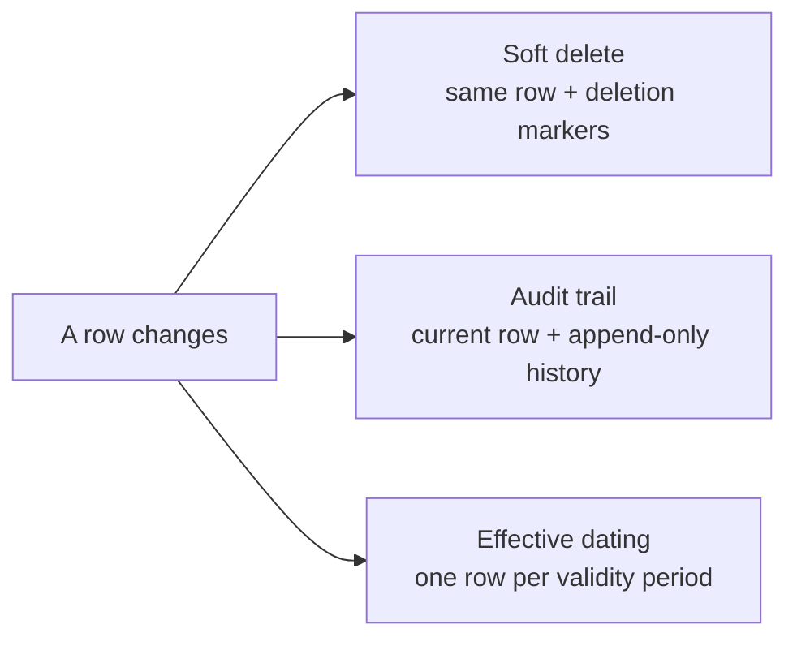
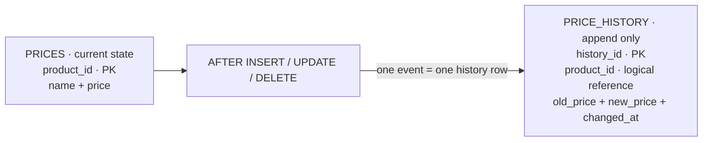
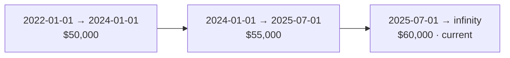

# PATTERN 7: TEMPORAL / AUDIT PATTERNS

Tracking data changes over time. Three common approaches.

## VISUALIZATION



```sql
drop schema if exists temporal cascade;
create schema temporal;
```

## APPROACH A: SOFT DELETE

Mark rows as deleted instead of removing them. Simple, preserves history, but requires filtering everywhere.

```sql
create table temporal.products_soft (
    product_id int generated always as identity primary key,
    name       varchar(200) not null,
    price      numeric(10, 2) not null check (price >= 0),
    is_deleted boolean not null default false,
    deleted_at timestamptz,
    created_at timestamptz not null default now(),
    updated_at timestamptz not null default now(),
    constraint chk_deleted_consistent
        check (
            (is_deleted and deleted_at is not null) or
            (not is_deleted and deleted_at is null)
        )
);

-- Partial unique index: only active rows must be unique
create unique index idx_products_active_name
    on temporal.products_soft (name)
    where not is_deleted;

-- Soft delete
update temporal.products_soft
set is_deleted = true, deleted_at = now()
where product_id = 5;

-- Query only active products
select * from temporal.products_soft where not is_deleted;
```

## APPROACH B: AUDIT TRAIL (HISTORY TABLE)

Separate table records every change. Main table has current state.

### VISUALIZATION



```sql
create table temporal.prices (
    product_id int generated always as identity primary key,
    name       varchar(200) not null,
    price      numeric(10, 2) not null check (price >= 0)
);

create table temporal.price_history (
    history_id  bigint generated always as identity primary key,
    product_id  int not null,          -- deliberately NOT a foreign key, see below
    old_price   numeric(10, 2),
    new_price   numeric(10, 2),        -- NULL on DELETE
    changed_by  text not null default current_user,
    changed_at  timestamptz not null default now(),
    change_type varchar(10) not null check (change_type in ('INSERT', 'UPDATE', 'DELETE')),

    check (
        (change_type = 'INSERT' and new_price is not null) or
        (change_type = 'UPDATE' and new_price is not null) or
        (change_type = 'DELETE' and old_price is not null)
    )
);

create index idx_price_history_product on temporal.price_history (product_id, changed_at desc);

-- Trigger-based audit trail
create or replace function temporal.audit_price_changes()
returns trigger as $$
begin
    if tg_op = 'INSERT' then
        insert into temporal.price_history (product_id, new_price, change_type)
        values (new.product_id, new.price, 'INSERT');
        return new;
    elsif tg_op = 'UPDATE' then
        if old.price is distinct from new.price then
            insert into temporal.price_history (product_id, old_price, new_price, change_type)
            values (new.product_id, old.price, new.price, 'UPDATE');
        end if;
        return new;
    elsif tg_op = 'DELETE' then
        insert into temporal.price_history (product_id, old_price, change_type)
        values (old.product_id, old.price, 'DELETE');
        return old;
    end if;
    return null;
end;
$$ language plpgsql;

create trigger trg_price_audit
    after insert or update or delete on temporal.prices
    for each row execute function temporal.audit_price_changes();
```

> ⚠️ **Why `price_history.product_id` has no foreign key.** The obvious `references prices(product_id) on delete cascade` breaks the audit trail in two ways at once, and both are silent until you need the data:
>
> 1. **`CASCADE` deletes the history.** The one event you most need recorded — someone deleted this product — erases every prior record of it. An audit log that a deletion can wipe is not an audit log.
> 2. **The DELETE trigger cannot even fire.** In an `AFTER DELETE` trigger the parent row is already gone, so inserting a history row that references it fails with a foreign key violation — which aborts the DELETE itself. The table becomes undeletable.
>
> An audit table must **outlive** the rows it describes. Keep `product_id` as a plain column. Trading referential integrity for durability is the correct call here; it is one of the few places where a dangling reference is the point.

**Hardening the audit trail:**

```sql
-- Record WHO, not just what. current_user is the DB role, which is usually
-- the shared app user — capture the application's user id too.
--   In the app:  SELECT set_config('app.user_id', $1, true);
--   In the trigger:  current_setting('app.user_id', true)

-- Make the log append-only. Without this, anyone who can write to the audited
-- table can usually also rewrite its history.
revoke update, delete on temporal.price_history from public;

-- A generic audit trigger using to_jsonb() avoids writing one function per
-- table, and survives ALTER TABLE without modification:
create table temporal.audit_log (
    audit_id   bigint generated always as identity primary key,
    table_name text not null,
    row_pk     text not null,
    operation  text not null,
    old_row    jsonb,
    new_row    jsonb,
    changed_by text not null default current_user,
    app_user   text default current_setting('app.user_id', true),
    changed_at timestamptz not null default now()
);
```

The generic `to_jsonb(OLD)` / `to_jsonb(NEW)` approach is what most production audit systems use — one trigger function attached to many tables, no per-column maintenance. The tradeoff is that queries against the log need JSONB operators rather than plain columns.

## APPROACH C: EFFECTIVE DATING (SLOWLY CHANGING DIM)

Each row has a valid_from and valid_to date. Current row has valid_to = infinity.

### VISUALIZATION



```sql
create table temporal.emp_salary (
    emp_id      int not null,
    salary      numeric(10, 2) not null check (salary > 0),
    valid_from  date not null,
    valid_to    date not null default 'infinity'::date,
    primary key (emp_id, valid_from),
    constraint chk_dates check (valid_from < valid_to)
);

-- Get current salary
select emp_id, salary from temporal.emp_salary
where valid_to = 'infinity';

-- Get salary as of a specific date.
-- HALF-OPEN interval [valid_from, valid_to). Do NOT use BETWEEN here — see below.
select emp_id, salary from temporal.emp_salary
where '2024-06-15' >= valid_from and '2024-06-15' < valid_to;

-- Salary history for an employee
select emp_id, salary, valid_from, valid_to
from temporal.emp_salary
where emp_id = 1
order by valid_from;
```

> ⚠️ **`BETWEEN` is inclusive on both ends, and that is wrong for validity periods.** With contiguous rows — one ending `2024-01-01` and the next starting `2024-01-01` — `WHERE '2024-01-01' BETWEEN valid_from AND valid_to` matches **both**, so a query meant to return one salary returns two. Your report silently doubles.
>
> The fix is the half-open convention `[valid_from, valid_to)`: a period includes its start and excludes its end, so adjacent periods meet exactly without overlapping. Use `>= valid_from AND < valid_to` everywhere, and store `valid_to` as the instant the next period begins — not "the last day of this one." The alternative (storing `2023-12-31` and gapping) breaks the moment your granularity changes from days to timestamps.

### Preventing overlaps declaratively

The `chk_dates` constraint only validates one row. Nothing above stops two rows for the same employee from covering the same date — and once that happens, every "as of" query returns duplicates. A CHECK can't see other rows, but an **exclusion constraint** can:

```sql
create extension if not exists btree_gist;

create table temporal.emp_salary_safe (
    emp_id     int not null,
    salary     numeric(10, 2) not null check (salary > 0),
    validity   daterange not null,

    -- No two rows for the same employee may have overlapping validity
    exclude using gist (emp_id with =, validity with &&)
);

insert into temporal.emp_salary_safe values
    (1, 50000, daterange('2022-01-01', '2024-01-01', '[)')),
    (1, 55000, daterange('2024-01-01', '2025-07-01', '[)')),
    (1, 60000, daterange('2025-07-01', null, '[)'));   -- null = open-ended

-- INSERT ... (1, 70000, daterange('2024-06-01','2024-12-01'))
--   ERROR: conflicting key value violates exclusion constraint

-- As-of query: @> is "range contains element". Uses the GiST index.
select emp_id, salary from temporal.emp_salary_safe
where validity @> date '2024-06-15';

-- Current row
select emp_id, salary from temporal.emp_salary_safe
where upper_inf(validity);
```

Using `daterange` with `'[)'` bounds makes the half-open convention structural rather than a rule everyone has to remember — `@>` cannot be got wrong the way `BETWEEN` can. This is the single biggest upgrade available to an effective-dated table, and the reason to prefer range types over paired `from`/`to` columns in PostgreSQL.

For a full bitemporal model (tracking both when a fact was *true* and when it was *recorded*), add a second range — `system_time` — and the same exclusion constraint over both.

## APPROACH COMPARISON

| Approach | Answers | Complexity | Storage | Current-state queries |
|---|---|---|---|---|
| Soft Delete | "Can we undelete it?" | Low | Same | Need `WHERE deleted_at IS NULL` everywhere |
| Audit Trail | "Who changed what, when?" | Medium | 2×–10× | Unaffected — history is a separate table |
| Effective Dating | "What was true on date X?" | High | 2×–5× | Need `WHERE` on the period every time |

They're complementary, not alternatives. A system needing compliance *and* point-in-time reporting uses an audit trail for the "who" and effective dating for the "what was true."

**Choose by the question you must answer:**
- Only "is it deleted?" → soft delete
- "Who did this and when?" (compliance, forensics) → audit trail
- "Recompute last quarter's payroll using the salaries in effect then" → effective dating

### COMMON MISTAKES

- **`BETWEEN` for validity periods.** Inclusive on both ends; returns two rows at every boundary. Use half-open `[from, to)` or a range type.
- **A foreign key from the history table to the audited table.** `CASCADE` erases the audit trail, and `AFTER DELETE` triggers can't insert at all. See the warning above.
- **No exclusion constraint on effective-dated tables.** Overlapping periods are inevitable without one, and they corrupt every historical query silently.
- **Redundant `is_deleted` + `deleted_at` without a CHECK tying them together.** They will eventually disagree. A single nullable `deleted_at` avoids the problem entirely — `NULL` means live.
- **Soft delete breaking unique constraints.** A deleted user permanently reserves their email. Use a partial unique index (`WHERE deleted_at IS NULL`), as shown in Approach A.
- **Soft delete ignoring foreign keys.** `ON DELETE CASCADE` never fires, so children point at "deleted" parents and every join needs the filter. Miss one and deleted data leaks into a report.
- **Auditing by hand in application code.** Any path that bypasses the ORM — a migration, a psql session, another service — writes no history. Triggers fire regardless of who is writing.
- **Not indexing temporal columns.** `(emp_id, valid_from)`, `deleted_at`, `(product_id, changed_at DESC)`. History tables grow fastest and are indexed least.
- **Letting history grow unbounded.** Audit tables are prime candidates for partitioning by `changed_at` with old partitions dropped or archived (see `../interview_sql_nodejs/07_practical_scenarios.md` Q4).

### KEY TAKEAWAYS

- Half-open intervals `[from, to)`, always — preferably as a `daterange`/`tstzrange`
- `EXCLUDE USING gist` is what actually prevents overlapping periods; a CHECK cannot
- Audit tables must survive deletion of the rows they describe, so no FK
- Triggers, not application code, because they can't be bypassed
